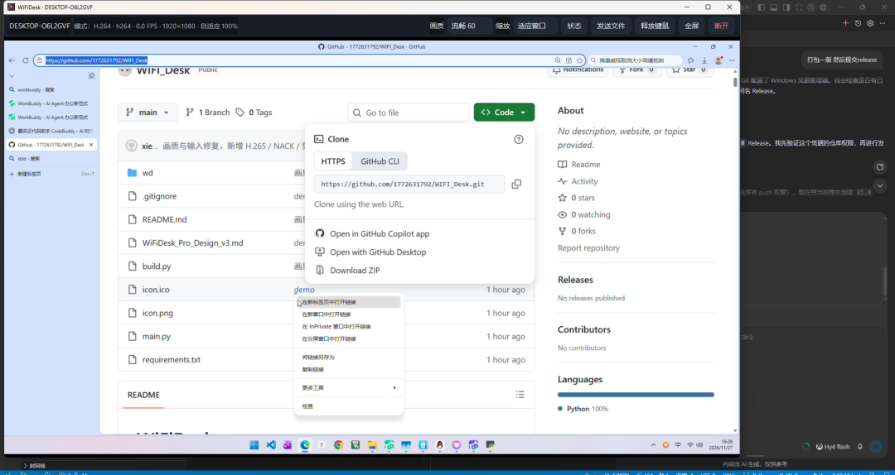

# WiFiDesk

<p align="center">
  
</p>

一个自己用的 Windows 局域网远程桌面。日常远程电脑太多，试过一圈主流的免费局域网远控：要么操作繁琐、要么画面发糊，局域网直连的效果还不如商业软件走公网。于是按"局域网内要做到比商业软件联网更好"的目标自己写了一个：DXGI 抓屏、H.265/H.264 硬件/软件编码、UDP 加密视频通道、键鼠二进制注入。

目标是**局域网内的画质、帧率、延迟对标商业远控**，而不是做一个通用产品：没有账号、没有中转服务器、不经过公网，两台机器在同一网段就能用。

## 界面预览



远端 1920×1080 画面；标题栏显示编码格式、帧率、分辨率与画质档位，工具栏可切换画质、缩放、窗口模式和文件传输。

## 主要特性

- **发现**：UDP 广播自动发现，报文用 AES-GCM 加密，同网段的其它扫描器只能看到随机字节。
- **安全**：TLS 1.2+ 双向自签证书 + 证书指纹 TOFU；私钥用 DPAPI 保护；媒体层 AES-GCM，密钥经 TLS 一次性分发。
- **视频**：DXGI Desktop Duplication 采集（硬件加速窗口不黑块）→ 合成鼠标指针 → H.265 / H.264 编码（CRF 恒定质量 + 1 秒 VBV 上限）→ ≤1200 字节 UDP 分片 → AES-GCM → UDP。
- **可靠性**：序号重放窗口 + NACK 逐包重传（丢 1 片实测 47ms 补齐，不再等关键帧）+ 缺口请求关键帧 + 断线 resume。
- **输入**：键鼠走紧凑二进制（鼠标 5 字节、按键 3 字节），TCP_NODELAY；远端画面内绘制指针、本地箭头自动隐藏。
- **剪贴板**：Ctrl+V 把本地文本推过去，Ctrl+C/X 把远端文本取回来。
- **文件**：拖进窗口或点"发送文件"，落到被控端 `%USERPROFILE%\Downloads\WiFiDesk\`，传输期间画面自动降到 8 FPS 让带宽。
- **自适应**：按 RTT 和丢失率调码率/画质；编码跟不上时优先保分辨率（换编码器 → 换快预设），最后才降分辨率。

## 优点

- **画质优先**：CRF 恒定质量 + H.265 省码率；带宽或编码吃紧时先降帧率、换编码器/快预设，最后才动分辨率，避免"一卡就糊"。
- **局域网低延迟**：DXGI 采集 3–5 ms，UDP 媒体通道 + TCP_NODELAY + NACK 逐包重传，丢 1 片实测 47 ms 内补齐。
- **不依赖公网服务**：无账号、无中转；UDP 发现和控制/媒体都加密，自签证书 + 指纹 TOFU，私钥用 DPAPI 保护。
- **日常操作够用**：自动发现、键鼠注入、远端指针合成、剪贴板双向、文件拖放、断线重连。
- **可观测、可打包**：状态栏能看 FPS/RTT/码率/编解码耗时；`build.py` 产物带版本资源、SHA-256 和自检。

## 缺点 / 限制

- **只适合 Windows 局域网**：两端都要运行，且需在同一网段；不支持公网、跨网段和手机端。协议改动必须两端同步版本。
- **环境依赖较强**：采集依赖 DXGI Desktop Duplication，虚拟机、RDP 会话、无显卡/远程桌面环境可能抓不到或黑屏。
- **低配机器仍会退化**：H.265 软件编码较吃 CPU；跟不上时会自动退到 H.264/快预设，极端情况才降分辨率。AV1 未启用（本机 PyAV 解码不可用）。
- **不是多人/企业产品**：没有账号体系、集中权限、审计、会话录制和音频；授权靠首次指纹确认与短码，适合自己人之间用。
- **文件传输会占带宽**：走控制 TCP，传输时画面自动降到 8 FPS；大文件期间远控体验明显变差。
- **静态画面帧率会偏低**：采集是事件驱动的，没新画面时标题栏可能显示 15 FPS 左右，这是省资源设计，不是掉帧。
- **打包体积较大**：便携包约 135 MB（含 PySide6 / PyAV / OpenCV 运行时）；首次连接还要核对证书指纹。

## 实测参考（1080p，同机回环）

| 项目 | 数值 |
| --- | --- |
| 采集（DXGI） | 3–5 ms/帧 |
| 编码 H.264 CRF19–22 | 6–9 ms/帧 |
| 编码 H.265 CRF24 | 9–15 ms/帧（同画质省约 40% 码率） |
| 客户端解码 | 2–8 ms/帧 |
| 帧率 | 30 档 28–29 FPS；"流畅 60" 档 54–57 FPS |
| 丢包恢复 | 丢 1 个分片 → 47 ms 内补齐 |

## 快速开始

```bash
pip install -r requirements.txt
python main.py            # 正常启动
python main.py --self-test  # 不开界面，检查配置/采集/编码器/TLS
```

两台机器都要运行；被控端在设置里勾选"允许连接"，授权模式选"自动允许"即为免密直连（状态栏会显示本次会话短码，便于当面核对）。

打包（产物带版本号和 SHA-256）：

```bash
python build.py        # 默认 1.0 → dist/WiFiDesk_V1.0/
python build.py 1.1    # 指定版本
```

---

# 调用链（AI 接手 / 二次开发）

面向接手代码的 AI 或开发者：模块职责、线程、关键流程、协议消息、以及容易踩的坑。函数级索引在文末。

## 0. 快速定位

| 目标 | 位置 |
| --- | --- |
| 入口 | `main.py` → `main()` |
| 自检 | `main.py` → `self_test()`，`python main.py --self-test` |
| 主界面 / 远控窗口 | `wd/wd_ui.py` → `MainWindow`、`RemoteWindow`、`RemoteView` |
| 设备发现 | `wd/wd_discovery.py` → `DiscoveryWorker` |
| 被控服务 | `wd/wd_session.py` → `ServerSession`、`ClientHandler` |
| 主控连接 | `wd/wd_session.py` → `ClientSession` |
| 控制协议 | `wd/wd_protocol.py`（`send_msg` / `recv_msg` / `MessageSender`） |
| 采集 / QoS | `wd/wd_capture.py`（`ScreenCapture` / `AdaptiveQuality` / `PRESETS`） |
| 指针合成 | `wd/wd_cursor.py` |
| 编码器 | `wd/wd_codec.py`（`select_encoder` / `H264Encoder` / `H264Decoder`） |
| UDP 视频通道 | `wd/wd_media.py`（`MediaTx` / `MediaRx`） |
| 键鼠 | `wd/wd_input.py`（`encode_event` / `inject` / `qt_key_to_vk`） |
| 剪贴板 | `wd/wd_clipboard.py`（`set_text` / `get_text`） |
| 配置 | `wd/wd_config.py` → `%APPDATA%\WiFiDesk\config.json` |
| 端口 | UDP `47381` 发现，TCP `47382` 控制 |
| 版本 | `build.py` → `APP_VERSION`（当前 1.0） |

## 1. 启动

```text
main.py __main__
└─ main()
   ├─ wd_config.Config()               # 读/建 config.json，确保证书存在
   │  └─ wd_crypto.ensure_material()   # 首次生成 RSA 2048 自签证书 + DPAPI 保护私钥
   ├─ [--self-test] self_test()        # 配置 / 采集 / 编码器探测 / TLS / 端口
   ├─ QApplication + wd_theme.apply_theme()
   └─ MainWindow(config)
      ├─ DiscoveryWorker(config)       # 发现线程
      ├─ ServerSession(config)         # 被控监听
      ├─ _build() / _wire()
      │  └─ wd-network 线程 → network_status()（netsh，静默 + 30s 缓存）
      ├─ apply_role()                  # 按角色 start/stop ServerSession
      └─ discovery.start()
```

## 2. 设备发现（加密广播）

```text
DiscoveryWorker._run()                        # 线程 wd-discovery
├─ discovery_ips() → wifi_ips() → _probe_wifi_ips()
│  └─ run_quiet(["netsh", ...])               # CREATE_NO_WINDOW，避免闪黑框
├─ sock.bind((WiFi IP, 47381))
├─ 每 2~4 秒 → discovery_datagram(_pid())
│  └─ "WFD2" + 12 字节随机 nonce + AES-GCM(JSON)   # 同网段扫描器只能看到随机字节
├─ recvfrom() → parse_datagram()              # 解不开直接丢弃
├─ kind=probe → 允许被控时 reply（同样加密）
└─ kind=reply → device_found.emit(info)
```

`device_found` → `MainWindow.refresh_devices()` → `DeviceRow` → `on_connect()`。

## 3. 主控握手

```text
MainWindow.on_connect(device)
└─ ClientSession(config, device, quality).start()   # 线程 wd-controller
   └─ _run()
      ├─ socket.create_connection((ip, 47382), 5s)
      ├─ send_msg("HELLO_PLAIN", id/name/fp/cert)
      ├─ recv_msg() → TLS_READY(cert) 或 AUTH_DENIED
      ├─ 校验服务端证书指纹 == device["fp"]
      ├─ tls_context(client, peer_pem) → wrap_socket → _tune_tcp()（TCP_NODELAY）
      ├─ send_msg("HELLO", id/name/fp/quality/media_port)
      ├─ recv_msg() → HELLO_OK(w/h/fps/name/resume/media)
      ├─ _reserve_media_socket() + _start_media(ip, meta, w, h)   # 见 4
      ├─ connected.emit() → MainWindow.on_connected() → RemoteWindow
      ├─ 线程 wd-frame-recv → _recv_loop()
      └─ 每 1 秒 PING（带 rtt）+ MEDIA_ACK（frames/lost/err）
```

被控端对应：

```text
ServerSession._accept_loop() → 线程 wd-client-handler → ClientHandler.run()
├─ 收 HELLO_PLAIN，校验客户端指纹，按 auth_mode 决定 自动放行 / 弹窗确认 / 拒绝
├─ TLS_READY → wrap_socket → _tune_tcp()
├─ 收 HELLO，config.remember(...)
├─ _start_media(media_port, size)     # 建 MediaTx + 编码器（用真实帧选型）
├─ send_msg("HELLO_OK", ..., media={port,key,nonce,epoch,codec})
├─ 线程 wd-ctrl-recv → _recv_loop()
├─ 线程 wd-ctrl-hb  → 1 秒心跳
└─ _send_loop(screen)                # 见 5
```

## 4. 媒体通道协商

```text
ClientHandler._start_media(port, size)
├─ wd_media.MediaTx(peer, key, nonce, epoch, bitrate)   # 同时开 wd-media-control 收控制包
├─ sample = capture.grab()                              # 用真实画面做编码器基准
├─ wd_codec.H264Encoder(ew, eh, fps, bitrate, crf, family, sample)
│  └─ select_encoder()：实测各候选 → 能跟上帧率就优先 H.265，同族优先软件 CRF
└─ 返回 {port, key, nonce, epoch, codec:"h264"|"hevc"}
```

主控端 `ClientSession._start_media(ip, meta, w, h)`：创建本地 UDP socket 与 `MediaRx(codec=...)`，启动 `wd-media-rx`。收不到 ACK 或 3 秒无确认 → `_media_off()` 回退图块通道（`FRAME_TILES`/`FRAME_JPEG`）。

## 5. 视频发送与接收

```text
ClientHandler._send_loop(screen)                     # 线程 wd-client-handler
├─ screen.grab()                                    # 无新帧返回 None → 跳过编码
│  ├─ dxcam DXGI（无新帧返回 None）
│  └─ wd_cursor.draw(frame)                         # 把系统指针合成进画面
├─ _send_video(screen, cur)
│  ├─ 决定编码尺寸 ew/eh（encode_scale）
│  ├─ 编码器 stale 检查（尺寸/fps/fast/强制编码器）→ 必要时重建
│  ├─ encoder.encode(cur) → EncodedFrame(data, keyframe)
│  └─ media_tx.send(data, keyframe, frame_id)
│     ├─ 分片 ≤1200B，逐片 AES-GCM（nonce = 前缀 + seq）
│     ├─ 1 秒码率突发额度限速
│     └─ 保留最近 512 个包用于 NACK 重发
└─ 每秒 _publish_stats() → qos.observe() + 自适应 + stats.emit()
```

```text
ClientSession._recv_loop()                            # 线程 wd-frame-recv（仅控制/图块）
MediaRx._run()                                        # 线程 wd-media-rx
├─ recvfrom → _handle()
│  ├─ 校验 magic/version/epoch/长度 → _accept_seq（4096 重放窗口）
│  ├─ AES-GCM 解密 → 按 frame_id 重组
│  ├─ 发现序号缺口 → _maybe_nack()（8ms 节流，最多点名 16 个）
│  └─ 齐了 → _deliver() → H264Decoder.decode() → cv2 YUV→RGB
└─ on_frame → ClientSession._on_media_rgb() → QImage.copy → frame_ready
```

`MediaTx._handle_nack()` 从 history 直接重发原密文（同 seq、同 nonce，不重复加密）。关键帧丢失时 `MediaRx` 发 `WFQ1` 请求，服务端 `encoder.request_keyframe()`。

## 6. 键鼠注入

```text
RemoteView.mouseMoveEvent → RemoteWindow.mouse_move()
├─ native_pos() 归一化到 0..1（按画布尺寸，与编码分辨率无关）
└─ ClientSession.send_input({"a":"move","nx","ny"})
   └─ wd_input.encode_event() → _send("INPUT2", 5B)
      └─ [网络] ClientHandler._recv_loop → decode_event() → wd_input.inject()
         └─ SendInput(ABSOLUTE|MOVE / BUTTON / WHEEL / KEY)
```

键盘：`RemoteView.keyPressEvent` → `key_press()` → `qt_key_to_vk()` → `INPUT2`。失焦时 `release_all()` 发 `{"a":"reset"}` 释放所有按键与鼠标键。

## 7. 剪贴板

```text
Ctrl+V → ClientSession.push_clipboard() → CLIP_SET(UTF-8)
        → 被控端 wd_clipboard.set_text()
Ctrl+C/X → ClientSession.request_clipboard() → CLIP_GET
        → 被控端延迟重读 get_text() → CLIP_TEXT
        → 主控端 clipboard_text 信号（GUI 线程）→ 写入本地剪贴板
```

## 8. 文件传输

```text
RemoteWindow 拖放 / "发送文件" → ClientSession.send_files(paths)
└─ 线程 wd-file-tx
   ├─ FILE_BEGIN{id,name,size}
   ├─ FILE_CHUNK（128KB，payload 为原始字节）
   │  └─ _wait_outstanding()：队列积压 ≤2MB，避免大文件把内存顶爆
   └─ FILE_END{id,ok}
      └─ 被控端 _file_begin/_chunk/_end → 写入 ~/Downloads/WiFiDesk/（重名加 (1)）
```

传输期间 `transfer_active=True`，`_send_loop` 把画面降到 8 FPS 让出带宽。

## 9. 自适应与回退顺序

`AdaptiveQuality.observe(rtt, pending, dropped, loss)`：按 RTT 与**丢失率**（不是绝对丢包数）做 2 秒迟滞调级，`level` 1.0 → 0.55。

```text
慢编码（load = 采集 + 编码 > 帧预算×0.8，连续 2 次）
├─ 1) family == hevc  → 改 H.264（保持分辨率，发 MEDIA_CODEC）
├─ 2) 未用快预设     → libx264/libx265 换 ultrafast
└─ 3) 仍慢           → encode_scale 100% → 75% → 50%（主控端放大显示）
恢复：连续 8 次余量充足才逐级升回分辨率；快预设与编码格式不回落，避免抖动。
```

## 10. 断线重连

```text
任一端断开 → ClientSession.disconnected → RemoteWindow._on_disconnected()
├─ release_all()（避免远端卡住按键）
├─ 覆盖层提示 + QTimer 指数退避（2/4/8/16/30 秒）
└─ _try_reconnect() → MainWindow.reconnect_client() → 新建 ClientSession + bind_client()
```

不要复用旧 `ClientSession`：旧接收线程可能把新连接关掉。服务端有 120 秒 `resume` 凭据，同一证书身份重连免二次授权。

## 11. 关闭

`MainWindow.closeEvent()` → client.stop() → 各 RemoteWindow.close() → server.stop() → discovery.stop()。

## 12. 协议消息

控制通道：8 字节头 `>II`（header_len, payload_len）+ JSON header + payload。

| 方向 | 类型 | 说明 |
| --- | --- | --- |
| 主控→被控 | `HELLO_PLAIN` | id/name/fp/cert/resume |
| 被控→主控 | `TLS_READY` / `AUTH_DENIED` | cert / reason |
| 主控→被控 | `HELLO` | id/name/fp/quality/media_port |
| 被控→主控 | `HELLO_OK` | w/h/fps/name/resume/media |
| 主控→被控 | `INPUT2` | 二进制：M/B/W/K/R |
| 主控→被控 | `INPUT` | 旧 JSON 格式，保留兼容 |
| 主控→被控 | `QUALITY` / `RESYNC` | preset / 请求整屏 |
| 主控→被控 | `CLIP_SET` / `CLIP_GET` | 推送文本 / 索取文本 |
| 被控→主控 | `CLIP_TEXT` | 被控端剪贴板文本 |
| 主控→被控 | `FILE_BEGIN/FILE_CHUNK/FILE_END` | 文件分片 |
| 双向 | `PING` / `PONG` | 1 秒心跳，带 rtt |
| 主控→被控 | `MEDIA_ACK` | 已解码帧数 / 丢帧 / 解码错误 |
| 双向 | `MEDIA_KEY` / `MEDIA_OFF` / `MEDIA_CODEC` | 关键帧请求 / 关通道 / 换编码格式 |
| 被控→主控 | `FRAME_TILES` / `FRAME_JPEG` | 图块/JPEG 回退通道 |
| 双向 | `DISCONNECT` | - |

UDP 视频通道（`wd/wd_media.py`）：`WFV1` 视频分片、`WFQ1` 关键帧请求、`WNK1` NACK（各自独立 nonce 前缀，避免 GCM nonce 复用）。
发现报文：`WFD2` + nonce + AES-GCM(JSON)。

## 13. 线程

| 线程 | 入口 | 职责 |
| --- | --- | --- |
| Qt 主线程 | `app.exec()` | 所有控件、信号槽、剪贴板写入 |
| `wd-network` | `MainWindow._build()` | `network_status()`（netsh） |
| `wd-discovery` | `DiscoveryWorker.start()` | UDP 广播/应答 |
| `wd-accept` | `ServerSession.start()` | TCP accept |
| `wd-client-handler` | `ServerSession._accept_loop()` | 一个连接一个：握手 + `_send_loop` |
| `wd-ctrl-recv` | `ClientHandler.run()` | 收主控指令（输入/剪贴板/文件/QoS） |
| `wd-ctrl-hb` | `ClientHandler.run()` | 1 秒心跳 |
| `wd-sender` | `MessageSender.start()` | 单线程写 socket，控制消息插队、视频只留最新 |
| `wd-controller` | `ClientSession.start()` | 主控握手 + 心跳 |
| `wd-frame-recv` | `ClientSession._run()` | 收图块/JPEG/控制消息 |
| `wd-media-rx` | `MediaRx.start()` | 收视频分片、NACK、解码、回调 |
| `wd-media-control` | `MediaTx.start_control()` | 收关键帧请求与 NACK |
| `wd-file-tx` | `ClientSession.send_files()` | 文件分片发送 |
| `wd-clip` / `wd-clip-get` | 被控端收到 `CLIP_SET`/`CLIP_GET` | 写/读系统剪贴板 |

## 14. 容易踩的坑（改代码前必读）

1. **帧节拍必须用 `time.perf_counter()`**。Windows 上 `time.monotonic()` 只有约 15.6ms 粒度，用它算 30/60 FPS 的间隔会每帧多睡一次，帧率直接掉到 20。
2. **TLS 上不要并发阻塞读**。读写都在同一 socket 时，`recv_exact` 必须先查 `sock.pending()` 再 `select`，否则握手读进 SSL 缓冲的数据 select 看不到，双方互等直到超时。
3. **编码器选型要用真实抓屏帧**。用空白图测会低估复杂画面 2 倍以上，选出来的 H.265 现场跟不上，只能降分辨率。
4. **关键帧不要 `decoder.reset()`**。IDR 本身会让解码器重置；每次重建 CodecContext 是 5–10ms 卡顿，1 秒 GOP 就是每秒卡一下。
5. **NACK 重发必须发原密文**。同 seq 重新加密会复用 GCM nonce；重复包由接收端重放窗口丢弃。
6. **鼠标坐标是归一化的**，与编码分辨率、缩放无关；`HELLO_OK` 的 w/h 是远端真实屏幕尺寸，不是码流尺寸。
7. **`MediaTx` 的限速按整帧**、突发额度 1–4MB；改成逐片 sleep 会把帧率压到 20 左右。
8. **子进程一律走 `wd_discovery.run_quiet()`**，否则窗口模式下每次调用都会闪一个黑框。
9. **重连不要复用旧 `ClientSession`**，旧接收线程可能关掉新连接。
10. **改协议要同时改两端**：发现报文、`INPUT2`、`MEDIA_CODEC` 都是同版本才兼容。

## 15. 排查：状态栏字段

- 主控端标题：`模式：H.265 · hevc · 29 FPS · 1920×1080（画面 960×540） · 自适应 100%`
  - 出现 `（画面 …）` 说明服务端降了编码分辨率，画质会发软。
- 主控端状态面板：`FPS / RTT / kbps / 解码 xx ms / 自适应 / 编码格式`。
- 被控端状态栏：`正在被控 · H.265·libx265(软件) · 29 FPS · 3.2 Mbps · 采集 4ms · 编码 12ms · 自适应 100% · 目标 30M`。

## 16. 目录

```text
main.py                 入口/自检
build.py                打包（版本号、版本资源、SHA-256）
wd/wd_ui.py             主界面、远控窗口、设置、拖放
wd/wd_session.py        服务端会话、主控会话、媒体协商、文件、剪贴板
wd/wd_media.py          UDP 视频通道（分片/加密/重组/NACK）
wd/wd_codec.py          编码器选择、H.264/H.265 编解码、RGB→YUV
wd/wd_capture.py        DXGI 采集、瓦片差异、QoS 预设
wd/wd_cursor.py         鼠标指针合成
wd/wd_input.py          SendInput 注入、按键映射、二进制输入编码
wd/wd_clipboard.py      剪贴板读写
wd/wd_protocol.py       控制协议、发送队列、发现报文加密
wd/wd_discovery.py      设备发现、WiFi 网卡探测
wd/wd_crypto.py         TLS/证书/指纹
wd/wd_config.py         配置与信任列表
wd/wd_theme.py          主题样式
```

## 17. 函数索引（AST 生成）

以下由 AST 从源码抽取，列出每个函数/方法的**直接调用**（已过滤语法节点与内建函数）。

按模块分组，行号为当前源码行号。

### main.py

- `main.py:7 _report()` → `join`、`dirname`、`write`
- `main.py:18 resource_path()` → `join`、`dirname`、`abspath`
- `main.py:26 self_test()` → `Config`、`ScreenCapture`、`grab`、`close`、`tls_context`、`socket`、`_report`、`probe`、`bind`、`AssertionError`、`get`
- `main.py:65 main()` → `ArgumentParser`、`add_argument`、`parse_args`、`Config`、`QApplication`、`setApplicationName`、`setWindowIcon`、`apply_theme`、`MainWindow`、`show`、`exec`、`self_test`、`QIcon`、`resource_path`、`get`

### wd/wd_capture.py


#### class `AdaptiveQuality`

- `wd/wd_capture.py:39 AdaptiveQuality.__init__()` → `monotonic`、`_set_floors`
- `wd/wd_capture.py:48 AdaptiveQuality._set_floors()` → （无外部调用）
- `wd/wd_capture.py:58 AdaptiveQuality.set_preset()` → `monotonic`、`_set_floors`
- `wd/wd_capture.py:67 AdaptiveQuality.observe()` → `monotonic`、`_apply`
- `wd/wd_capture.py:94 AdaptiveQuality._apply()` → `update`、`get`

#### class `ScreenCapture`

- `wd/wd_capture.py:111 ScreenCapture.__init__()` → `get`
- `wd/wd_capture.py:123 ScreenCapture.set_preset()` → `get`
- `wd/wd_capture.py:128 ScreenCapture.frame_size()` → `grab`
- `wd/wd_capture.py:136 ScreenCapture._ensure_camera()` → `monotonic`、`create`
- `wd/wd_capture.py:152 ScreenCapture._drop_camera()` → `monotonic`、`release`
- `wd/wd_capture.py:165 ScreenCapture.grab()` → `_ensure_camera`、`asarray`、`_draw_cursor`、`_is_black`、`grab`、`_drop_camera`
- `wd/wd_capture.py:195 ScreenCapture._is_black()` → `mean`
- `wd/wd_capture.py:199 ScreenCapture.close()` → （无外部调用）
- `wd/wd_capture.py:207 ScreenCapture.diff()` → `copy`、`snapshot`、`array_equal`、`append`
- `wd/wd_capture.py:225 ScreenCapture.snapshot()` → `copy`
- `wd/wd_capture.py:233 ScreenCapture.pack_tiles()` → `tobytes`、`compress`、`append`、`join`、`get`
- `wd/wd_capture.py:246 ScreenCapture.encode_jpeg()` → `cvtColor`、`imencode`、`tobytes`、`extend`

### wd/wd_clipboard.py

- `wd/wd_clipboard.py:28 get_text()` → `OpenClipboard`、`sleep`、`GetClipboardData`、`GlobalLock`、`CloseClipboard`、`wstring_at`、`GlobalUnlock`
- `wd/wd_clipboard.py:55 set_text()` → `GlobalAlloc`、`GlobalLock`、`encode`、`GlobalFree`、`memmove`、`GlobalUnlock`、`OpenClipboard`、`sleep`、`EmptyClipboard`、`CloseClipboard`、`SetClipboardData`

### wd/wd_codec.py

- `wd/wd_codec.py:44 family_of()` → `startswith`
- `wd/wd_codec.py:48 _open_encoder()` → `create`、`Fraction`、`get`
- `wd/wd_codec.py:76 _to_frame()` → `from_ndarray`、`reformat`、`ascontiguousarray`、`resize`、`cvtColor`、`empty`、`reshape`、`copy`
- `wd/wd_codec.py:113 _benchmark()` → `_open_encoder`、`_to_frame`、`encode`、`perf_counter`、`zeros`、`resize`
- `wd/wd_codec.py:136 select_encoder()` → `get`、`_benchmark`、`append`
- `wd/wd_codec.py:255 _frame_to_rgb()` → `to_ndarray`、`cvtColor`
- `wd/wd_codec.py:293 probe()` → `select_encoder`、`upper`

#### class `EncodedFrame`


#### class `H264Encoder`

- `wd/wd_codec.py:174 H264Encoder.__init__()` → `_open_encoder`、`Lock`、`select_encoder`、`family_of`、`values`
- `wd/wd_codec.py:204 H264Encoder.request_keyframe()` → （无外部调用）
- `wd/wd_codec.py:207 H264Encoder.set_bitrate()` → `set_quality`
- `wd/wd_codec.py:210 H264Encoder.set_quality()` → `_open_encoder`
- `wd/wd_codec.py:234 H264Encoder.encode()` → `_to_frame`、`encode`、`join`、`EncodedFrame`
- `wd/wd_codec.py:250 H264Encoder.close()` → （无外部调用）

#### class `H264Decoder`

- `wd/wd_codec.py:263 H264Decoder.__init__()` → `create`、`Lock`
- `wd/wd_codec.py:268 H264Decoder._reset_locked()` → `create`、`flush_buffers`
- `wd/wd_codec.py:275 H264Decoder.reset()` → `_reset_locked`
- `wd/wd_codec.py:279 H264Decoder.decode()` → `decode`、`_frame_to_rgb`、`Packet`、`_reset_locked`
- `wd/wd_codec.py:288 H264Decoder.close()` → （无外部调用）

### wd/wd_config.py


#### class `Config`

- `wd/wd_config.py:27 Config.__init__()` → `makedirs`、`join`、`exists`、`ensure_material`、`save`、`get`、`uuid4`、`load`、`update`
- `wd/wd_config.py:49 Config.get()` → `get`
- `wd/wd_config.py:52 Config.set()` → `save`
- `wd/wd_config.py:56 Config.save()` → `replace`、`dump`
- `wd/wd_config.py:63 Config.device_id()` → （无外部调用）
- `wd/wd_config.py:67 Config.device_name()` → （无外部调用）
- `wd/wd_config.py:71 Config.role()` → `get`
- `wd/wd_config.py:74 Config.may_control()` → （无外部调用）
- `wd/wd_config.py:77 Config.may_be_controlled()` → （无外部调用）
- `wd/wd_config.py:80 Config.is_auto_trusted()` → `get`
- `wd/wd_config.py:86 Config.remember()` → `setdefault`、`get`、`update`、`save`
- `wd/wd_config.py:95 Config.forget()` → `pop`、`save`、`get`

### wd/wd_crypto.py

- `wd/wd_crypto.py:19 _dpapi()` → `create_string_buffer`、`DATA_BLOB`、`fn`、`string_at`、`LocalFree`、`cast`、`byref`、`POINTER`、`get_last_error`
- `wd/wd_crypto.py:36 protect()` → `_dpapi`
- `wd/wd_crypto.py:40 unprotect()` → `_dpapi`
- `wd/wd_crypto.py:44 _generate_certificate()` → `generate_private_key`、`Name`、`replace`、`sign`、`private_bytes`、`public_bytes`、`SHA256`、`NoEncryption`、`NameAttribute`、`now`、`add_extension`、`SubjectAlternativeName`、`not_valid_after`、`DNSName`、`not_valid_before`、`timedelta`、`serial_number`、`random_serial_number`、`public_key`、`issuer_name`、`subject_name`、`CertificateBuilder`
- `wd/wd_crypto.py:74 ensure_material()` → `makedirs`、`join`、`PEM_cert_to_DER_cert`、`hexdigest`、`_generate_certificate`、`read`、`exists`、`write`、`sha256`、`protect`
- `wd/wd_crypto.py:91 tls_context()` → `join`、`mkstemp`、`unprotect`、`fdopen`、`write`、`SSLContext`、`load_cert_chain`、`read`、`load_verify_locations`、`exists`、`remove`
- `wd/wd_crypto.py:130 fingerprint()` → `hexdigest`、`PEM_cert_to_DER_cert`、`sha256`
- `wd/wd_crypto.py:138 short_code()` → `rstrip`、`join`、`fromhex`、`decode`、`b32encode`

#### class `DATA_BLOB`


### wd/wd_cursor.py

- `wd/wd_cursor.py:67 _read_sprite()` → `ICONINFO`、`GetIconInfo`、`BITMAP`、`GetDC`、`CreateCompatibleDC`、`SelectObject`、`BITMAPINFOHEADER`、`sizeof`、`GetDIBits`、`DeleteDC`、`ReleaseDC`、`copy`、`byref`、`GetObjectW`、`DeleteObject`、`reshape`、`frombuffer`
- `wd/wd_cursor.py:110 _cursor_sprite()` → `CURSORINFO`、`sizeof`、`monotonic`、`_read_sprite`、`update`、`GetCursorInfo`、`byref`
- `wd/wd_cursor.py:129 draw()` → `_cursor_sprite`、`astype`

#### class `CURSORINFO`


#### class `ICONINFO`


#### class `BITMAP`


#### class `BITMAPINFOHEADER`


### wd/wd_discovery.py

- `wd/wd_discovery.py:16 run_quiet()` → `check_output`、`STARTUPINFO`
- `wd/wd_discovery.py:32 _usable_ip()` → `split`
- `wd/wd_discovery.py:47 wifi_ips()` → `monotonic`、`_probe_wifi_ips`、`update`
- `wd/wd_discovery.py:60 _probe_wifi_ips()` → `decode`、`splitlines`、`split`、`findall`、`local_ips`、`run_quiet`、`lower`、`strip`
- `wd/wd_discovery.py:87 local_ips()` → `socket`、`connect`、`add`、`close`、`getaddrinfo`、`gethostname`、`_usable_ip`、`getsockname`
- `wd/wd_discovery.py:106 discovery_ips()` → `wifi_ips`、`local_ips`
- `wd/wd_discovery.py:112 primary_ip()` → `discovery_ips`

#### class `DiscoveryWorker`

- `wd/wd_discovery.py:122 DiscoveryWorker.__init__()` → `__init__`
- `wd/wd_discovery.py:130 DiscoveryWorker.probe_now()` → （无外部调用）
- `wd/wd_discovery.py:133 DiscoveryWorker.start()` → `start`、`__import__`
- `wd/wd_discovery.py:137 DiscoveryWorker.stop()` → （无外部调用）
- `wd/wd_discovery.py:140 DiscoveryWorker._pid()` → `get`
- `wd/wd_discovery.py:151 DiscoveryWorker._targets()` → `discovery_ips`、`split`、`add`、`join`
- `wd/wd_discovery.py:159 DiscoveryWorker._run()` → `discovery_ips`、`socket`、`settimeout`、`emit`、`monotonic`、`close`、`get`、`setsockopt`、`bind`、`wifi_ips`、`_expire`、`may_control`、`recvfrom`、`parse_datagram`、`discovery_datagram`、`_targets`、`uniform`、`may_be_controlled`、`primary_ip`、`sendto`、`_pid`
- `wd/wd_discovery.py:227 DiscoveryWorker._expire()` → `monotonic`、`pop`、`emit`、`items`、`get`

### wd/wd_input.py

- `wd/wd_input.py:54 _send()` → `SendInput`、`sizeof`
- `wd/wd_input.py:61 screen_size()` → `GetSystemMetrics`
- `wd/wd_input.py:67 mouse_move()` → `screen_size`、`INPUT`、`_send`
- `wd/wd_input.py:76 mouse_button()` → `get`、`INPUT`、`_send`
- `wd/wd_input.py:89 mouse_wheel()` → `INPUT`、`DWORD`、`_send`
- `wd/wd_input.py:96 key()` → `INPUT`、`WORD`、`_send`
- `wd/wd_input.py:105 inject()` → `get`、`mouse_move`、`mouse_button`、`mouse_wheel`、`key`
- `wd/wd_input.py:126 qt_key_to_vk()` → `get`
- `wd/wd_input.py:158 encode_event()` → `get`、`pack`
- `wd/wd_input.py:179 decode_event()` → `unpack`

#### class `MOUSEINPUT`


#### class `KEYBDINPUT`


#### class `HARDWAREINPUT`


#### class `_INPUTUNION`


#### class `INPUT`


### wd/wd_media.py

- `wd/wd_media.py:45 _flip_prefix()` → （无外部调用）
- `wd/wd_media.py:49 _nack_prefix()` → （无外部调用）

#### class `MediaTx`

- `wd/wd_media.py:54 MediaTx.__init__()` → `setsockopt`、`setblocking`、`AESGCM`、`ljust`、`_flip_prefix`、`_nack_prefix`、`OrderedDict`、`Lock`、`monotonic`、`socket`、`bind`、`getsockname`
- `wd/wd_media.py:87 MediaTx.start_control()` → `start`
- `wd/wd_media.py:95 MediaTx._control_loop()` → `select`、`recvfrom`、`_handle_request`
- `wd/wd_media.py:112 MediaTx._handle_request()` → `unpack`、`monotonic`、`_handle_nack`、`pack`、`decrypt`、`_on_key_request`
- `wd/wd_media.py:138 MediaTx._handle_nack()` → `unpack`、`pack`、`decrypt`、`get`、`sendto`
- `wd/wd_media.py:168 MediaTx.set_bitrate()` → （无外部调用）
- `wd/wd_media.py:171 MediaTx._pace()` → `monotonic`、`sleep`
- `wd/wd_media.py:188 MediaTx.send()` → `_pace`、`pack`、`encrypt`、`sendto`、`popitem`
- `wd/wd_media.py:217 MediaTx.close()` → `close`

#### class `MediaRx`

- `wd/wd_media.py:225 MediaRx.__init__()` → `AESGCM`、`ljust`、`_flip_prefix`、`_nack_prefix`、`setsockopt`、`setblocking`、`Lock`、`socket`、`bind`、`getsockname`
- `wd/wd_media.py:267 MediaRx.start()` → `start`
- `wd/wd_media.py:271 MediaRx.stop()` → `close`
- `wd/wd_media.py:278 MediaRx.stats()` → （无外部调用）
- `wd/wd_media.py:288 MediaRx._maybe_nack()` → `monotonic`、`pack`、`join`、`get`、`append`、`sendto`、`items`、`encrypt`
- `wd/wd_media.py:321 MediaRx.set_codec()` → `H264Decoder`、`close`
- `wd/wd_media.py:334 MediaRx._accept_seq()` → `add`
- `wd/wd_media.py:347 MediaRx._request_keyframe()` → `monotonic`、`pack`、`on_keyframe`、`encrypt`、`sendto`
- `wd/wd_media.py:365 MediaRx._run()` → `H264Decoder`、`_handle`、`_expire`、`close`、`select`、`_maybe_nack`、`recvfrom`
- `wd/wd_media.py:391 MediaRx._expire()` → `monotonic`、`pop`、`items`
- `wd/wd_media.py:403 MediaRx._handle()` → `unpack`、`_maybe_nack`、`monotonic`、`get`、`join`、`pop`、`_deliver`、`_accept_seq`、`pack`、`decrypt`、`_request_keyframe`
- `wd/wd_media.py:454 MediaRx._deliver()` → `perf_counter`、`decode`、`_request_keyframe`、`frombuffer`、`copy`、`reset`、`on_snapshot`、`on_frame`、`decompress`、`reshape`

### wd/wd_protocol.py

- `wd/wd_protocol.py:27 _pending()` → `pending`
- `wd/wd_protocol.py:35 recv_exact()` → `join`、`monotonic`、`append`、`_pending`、`recv`、`TimeoutError`、`select`
- `wd/wd_protocol.py:68 send_msg()` → `encode`、`sendall`、`memoryview`、`get`、`pack`、`dumps`
- `wd/wd_protocol.py:189 recv_msg()` → `unpack`、`loads`、`recv_exact`、`decode`、`get`
- `wd/wd_protocol.py:198 discovery_datagram()` → `encode`、`urandom`、`encrypt`、`dumps`
- `wd/wd_protocol.py:206 parse_datagram()` → `loads`、`decrypt`、`decode`、`startswith`、`get`

#### class `MessageSender`

- `wd/wd_protocol.py:95 MessageSender.__init__()` → `deque`、`Condition`
- `wd/wd_protocol.py:107 MessageSender.start()` → `start`
- `wd/wd_protocol.py:112 MessageSender.stop()` → `clear`、`notify_all`
- `wd/wd_protocol.py:119 MessageSender.send()` → `send_batch`
- `wd/wd_protocol.py:123 MessageSender.send_batch()` → `notify`、`appendleft`、`append`、`_drop_oldest_video_locked`
- `wd/wd_protocol.py:141 MessageSender.pending_frames()` → （无外部调用）
- `wd/wd_protocol.py:145 MessageSender.flush()` → `monotonic`、`sleep`
- `wd/wd_protocol.py:154 MessageSender._drop_oldest_video_locked()` → （无外部调用）
- `wd/wd_protocol.py:163 MessageSender._run()` → `popleft`、`wait`、`send_msg`、`on_error`

### wd/wd_session.py

- `wd/wd_session.py:28 enable_fine_timer()` → `timeBeginPeriod`
- `wd/wd_session.py:41 _capture()` → （无外部调用）
- `wd/wd_session.py:47 _tune_tcp()` → `setsockopt`

#### class `ServerSession`

- `wd/wd_session.py:62 ServerSession.__init__()` → `__init__`、`Lock`
- `wd/wd_session.py:72 ServerSession.start()` → `enable_fine_timer`、`socket`、`setsockopt`、`settimeout`、`start`、`emit`、`bind`、`listen`、`close`、`get`
- `wd/wd_session.py:92 ServerSession.stop()` → `stop`、`close`
- `wd/wd_session.py:103 ServerSession._accept_loop()` → `ClientHandler`、`start`、`accept`、`close`
- `wd/wd_session.py:122 ServerSession.resolve_auth()` → `get`
- `wd/wd_session.py:129 ServerSession.issue_resume()` → `token_urlsafe`、`monotonic`、`items`、`pop`
- `wd/wd_session.py:142 ServerSession.check_resume()` → `get`、`monotonic`、`pop`
- `wd/wd_session.py:156 ServerSession.revoke_resume()` → `pop`
- `wd/wd_session.py:161 ServerSession.unregister()` → （无外部调用）

#### class `ClientHandler`

- `wd/wd_session.py:168 ClientHandler.__init__()` → `Lock`、`get`、`ScreenCapture`、`AdaptiveQuality`、`monotonic`、`_capture`
- `wd/wd_session.py:223 ClientHandler.stop()` → `_release_media`、`stop`、`shutdown`
- `wd/wd_session.py:234 ClientHandler._on_send_error()` → `emit`
- `wd/wd_session.py:238 ClientHandler._send()` → `send`、`send_msg`、`_on_send_error`
- `wd/wd_session.py:251 ClientHandler._heartbeat_loop()` → `sleep`、`_send`、`monotonic`
- `wd/wd_session.py:257 ClientHandler._apply_preset()` → `set_preset`、`_capture`
- `wd/wd_session.py:266 ClientHandler._release_media()` → `close`
- `wd/wd_session.py:286 ClientHandler._media_off()` → `_release_media`、`_send`、`emit`
- `wd/wd_session.py:295 ClientHandler._media_alive()` → `monotonic`、`_media_off`
- `wd/wd_session.py:306 ClientHandler._start_media()` → `monotonic`、`token_bytes`、`MediaTx`、`start_control`、`lower`、`H264Encoder`、`emit`、`hex`、`randbelow`、`get`、`grab`
- `wd/wd_session.py:348 ClientHandler._on_key_request()` → `request_keyframe`
- `wd/wd_session.py:353 ClientHandler._reply_clipboard()` → `sleep`、`_send`、`get_text`、`encode`
- `wd/wd_session.py:367 ClientHandler._send_video()` → `perf_counter`、`encode`、`send`、`get`、`H264Encoder`、`emit`、`set_quality`、`_media_off`、`close`、`_send`
- `wd/wd_session.py:446 ClientHandler._send_tiles()` → `diff`、`encode_jpeg`、`append`、`snapshot`、`pack_tiles`、`send_batch`
- `wd/wd_session.py:491 ClientHandler._publish_stats()` → `emit`、`pending_frames`、`observe`、`set_bitrate`、`get`、`close`
- `wd/wd_session.py:586 ClientHandler.run()` → `settimeout`、`recv_msg`、`fingerprint`、`check_resume`、`get`、`tls_context`、`send_msg`、`wrap_socket`、`setblocking`、`_tune_tcp`、`getpeercert`、`_apply_preset`、`remember`、`frame_size`、`issue_resume`、`MessageSender`、`start`、`_send`、`emit`、`_send_loop`、`_release_media`、`unregister`、`is_auto_trusted`、`token_hex`、`wait`、`pop`、`lower`、`_start_media`、`stop`、`_drop_upload`、`close`、`Event`、`short_code`
- `wd/wd_session.py:701 ClientHandler._send_loop()` → `_media_alive`、`perf_counter`、`monotonic`、`sleep`、`grab`、`emit`、`_send_tiles`、`_publish_stats`、`get`、`_send_video`
- `wd/wd_session.py:760 ClientHandler._upload_dir()` → `join`、`makedirs`、`expanduser`、`isdir`
- `wd/wd_session.py:768 ClientHandler._file_begin()` → `strip`、`emit`、`get`、`_upload_dir`、`join`、`splitext`、`exists`、`basename`、`replace`
- `wd/wd_session.py:798 ClientHandler._file_chunk()` → `get`、`write`、`emit`、`_drop_upload`、`basename`
- `wd/wd_session.py:815 ClientHandler._file_end()` → `pop`、`basename`、`get`、`close`、`emit`、`remove`
- `wd/wd_session.py:836 ClientHandler._drop_upload()` → `pop`、`close`
- `wd/wd_session.py:845 ClientHandler._recv_loop()` → `recv_msg`、`emit`、`_send`、`decode_event`、`loads`、`inject`、`decode`、`get`、`_apply_preset`、`start`、`_file_begin`、`_file_chunk`、`_file_end`、`_on_key_request`、`monotonic`、`_media_off`、`revoke_resume`

#### class `ClientSession`

- `wd/wd_session.py:921 ClientSession.__init__()` → `__init__`、`Lock`、`monotonic`、`connect`、`_capture`
- `wd/wd_session.py:958 ClientSession.start()` → `start`
- `wd/wd_session.py:961 ClientSession.stop()` → `_stop_media`、`stop`、`shutdown`
- `wd/wd_session.py:973 ClientSession._on_send_error()` → `emit`
- `wd/wd_session.py:978 ClientSession._send()` → `send`、`send_msg`、`_on_send_error`
- `wd/wd_session.py:991 ClientSession.send_input()` → `encode_event`、`_send`
- `wd/wd_session.py:996 ClientSession.request_clipboard()` → `_send`
- `wd/wd_session.py:1000 ClientSession._apply_clipboard()` → `setText`、`clipboard`
- `wd/wd_session.py:1007 ClientSession.push_clipboard()` → `text`、`encode`、`_send`、`emit`、`clipboard`
- `wd/wd_session.py:1020 ClientSession.send_files()` → `start`、`emit`、`isfile`
- `wd/wd_session.py:1029 ClientSession._send_files()` → `basename`、`token_hex`、`emit`、`_send`、`getsize`、`read`、`_wait_outstanding`
- `wd/wd_session.py:1072 ClientSession._wait_outstanding()` → `monotonic`、`sleep`
- `wd/wd_session.py:1087 ClientSession.set_quality()` → `_send`、`_capture`
- `wd/wd_session.py:1092 ClientSession.resync()` → `_send`
- `wd/wd_session.py:1097 ClientSession.take_frame()` → （无外部调用）
- `wd/wd_session.py:1103 ClientSession._reserve_media_socket()` → `socket`、`setsockopt`、`bind`、`emit`、`getsockname`
- `wd/wd_session.py:1115 ClientSession._start_media()` → `get`、`fromhex`、`MediaRx`、`start`、`emit`、`close`
- `wd/wd_session.py:1151 ClientSession._stop_media()` → `stop`、`close`
- `wd/wd_session.py:1163 ClientSession._media_key()` → `_send`
- `wd/wd_session.py:1166 ClientSession._on_media_rgb()` → `copy`、`isNull`、`_publish_stats`、`QImage`、`fill`、`emit`、`QColor`、`width`、`height`
- `wd/wd_session.py:1190 ClientSession._run()` → `emit`、`get`、`create_connection`、`settimeout`、`send_msg`、`recv_msg`、`tls_context`、`wrap_socket`、`setblocking`、`_tune_tcp`、`fingerprint`、`_reserve_media_socket`、`_send`、`QImage`、`fill`、`MessageSender`、`start`、`_start_media`、`_stop_media`、`QColor`、`sleep`、`stop`、`getpeercert`、`stats`、`close`、`monotonic`
- `wd/wd_session.py:1270 ClientSession._recv_loop()` → `_publish_stats`、`recv_msg`、`get`、`emit`、`_apply_tiles`、`resync`、`fromData`、`isNull`、`convertToFormat`、`copy`、`_send`、`_stop_media`、`decode`、`monotonic`、`set_codec`
- `wd/wd_session.py:1350 ClientSession._apply_tiles()` → `get`、`QPainter`、`QImage`、`fill`、`end`、`width`、`height`、`QColor`、`isNull`、`drawImage`、`decompress`
- `wd/wd_session.py:1396 ClientSession._publish_stats()` → `monotonic`、`emit`、`get`、`width`、`height`、`stats`

### wd/wd_theme.py

- `wd/wd_theme.py:34 tokens()` → （无外部调用）
- `wd/wd_theme.py:38 qss()` → `tokens`
- `wd/wd_theme.py:135 apply_theme()` → `tokens`、`setStyle`、`QPalette`、`setColor`、`setPalette`、`setStyleSheet`、`QColor`、`qss`

### wd/wd_ui.py

- `wd/wd_ui.py:23 network_status()` → `primary_ip`、`decode`、`splitlines`、`run_quiet`、`strip`、`split`

#### class `DragBar`

- `wd/wd_ui.py:39 DragBar.__init__()` → `__init__`、`setObjectName`、`setFixedHeight`
- `wd/wd_ui.py:47 DragBar.mousePressEvent()` → `button`、`setCursor`、`toPoint`、`pos`、`QCursor`、`globalPosition`
- `wd/wd_ui.py:53 DragBar.mouseMoveEvent()` → `move`、`toPoint`、`globalPosition`
- `wd/wd_ui.py:57 DragBar.mouseReleaseEvent()` → `unsetCursor`

#### class `DeviceRow`

- `wd/wd_ui.py:66 DeviceRow.__init__()` → `__init__`、`setObjectName`、`setFixedHeight`、`QHBoxLayout`、`setContentsMargins`、`setSpacing`、`QLabel`、`setStyleSheet`、`setFixedWidth`、`addWidget`、`QVBoxLayout`、`addLayout`、`QPushButton`、`setEnabled`、`connect`、`get`、`emit`
- `wd/wd_ui.py:105 DeviceRow.set_connecting()` → `setEnabled`、`setText`、`text`

#### class `PairDialog`

- `wd/wd_ui.py:111 PairDialog.__init__()` → `__init__`、`setWindowTitle`、`setModal`、`setFixedWidth`、`QVBoxLayout`、`setContentsMargins`、`setSpacing`、`QLabel`、`setStyleSheet`、`addWidget`、`setObjectName`、`QCheckBox`、`setEnabled`、`QDialogButtonBox`、`setText`、`connect`、`get`、`button`
- `wd/wd_ui.py:138 PairDialog.accept()` → `isChecked`、`accept`

#### class `SettingsDialog`

- `wd/wd_ui.py:144 SettingsDialog.__init__()` → `__init__`、`setWindowTitle`、`setFixedWidth`、`_build`、`_load`
- `wd/wd_ui.py:152 SettingsDialog._build()` → `QVBoxLayout`、`setContentsMargins`、`setSpacing`、`addWidget`、`QComboBox`、`addItems`、`QCheckBox`、`QLabel`、`setObjectName`、`setWordWrap`、`connect`、`QHBoxLayout`、`QSpinBox`、`setRange`、`addLayout`、`QTextEdit`、`setReadOnly`、`setFixedHeight`、`QLineEdit`、`setPlaceholderText`、`QPushButton`、`QDialogButtonBox`
- `wd/wd_ui.py:214 SettingsDialog._load()` → `setCurrentIndex`、`setChecked`、`get`、`setValue`、`_update_auth_hint`、`_refresh_trusted`
- `wd/wd_ui.py:229 SettingsDialog._update_auth_hint()` → `setText`、`currentIndex`
- `wd/wd_ui.py:237 SettingsDialog._refresh_trusted()` → `get`、`items`、`setPlainText`、`append`、`join`
- `wd/wd_ui.py:245 SettingsDialog._revoke()` → `strip`、`forget`、`clear`、`_refresh_trusted`、`text`
- `wd/wd_ui.py:252 SettingsDialog.accept()` → `accept`、`isChecked`、`value`、`currentIndex`

#### class `RemoteView`

- `wd/wd_ui.py:265 RemoteView.__init__()` → `__init__`、`setAlignment`、`setStyleSheet`、`setMouseTracking`、`setFocusPolicy`、`setCursor`
- `wd/wd_ui.py:276 RemoteView.mousePressEvent()` → `mouse_press`
- `wd/wd_ui.py:279 RemoteView.mouseReleaseEvent()` → `mouse_release`
- `wd/wd_ui.py:282 RemoteView.mouseMoveEvent()` → `mouse_move`
- `wd/wd_ui.py:285 RemoteView.wheelEvent()` → `mouse_wheel`
- `wd/wd_ui.py:288 RemoteView.keyPressEvent()` → `key_press`
- `wd/wd_ui.py:291 RemoteView.keyReleaseEvent()` → `key_release`
- `wd/wd_ui.py:294 RemoteView.focusOutEvent()` → `release_all`、`focusOutEvent`

#### class `RemoteWindow`

- `wd/wd_ui.py:300 RemoteWindow.__init__()` → `__init__`、`QImage`、`QTimer`、`setSingleShot`、`connect`、`setWindowTitle`、`setMinimumSize`、`setAcceptDrops`、`primaryScreen`、`resize`、`_build`、`setCurrentIndex`、`show`、`set_frame`、`availableGeometry`、`width`、`height`、`get`
- `wd/wd_ui.py:345 RemoteWindow._build()` → `QVBoxLayout`、`setContentsMargins`、`setSpacing`、`QWidget`、`setObjectName`、`setFixedHeight`、`QHBoxLayout`、`addWidget`、`QLabel`、`addStretch`、`QComboBox`、`addItems`、`setCurrentIndex`、`connect`、`QPushButton`、`setCheckable`、`setToolTip`、`hide`、`QTimer`、`setSingleShot`、`RemoteView`、`setAlignment`、`setStyleSheet`、`QFrame`、`index`、`get`、`set_quality`、`update_view`
- `wd/wd_ui.py:419 RemoteWindow.resizeEvent()` → `resizeEvent`、`_place_overlay`、`update_view`、`isFullScreen`、`isVisible`、`resize`、`move`、`width`
- `wd/wd_ui.py:427 RemoteWindow._place_overlay()` → `isVisible`、`geometry`、`setGeometry`、`x`、`y`、`width`、`height`
- `wd/wd_ui.py:437 RemoteWindow.set_frame()` → `take_frame`、`update_view`、`sender`、`isNull`
- `wd/wd_ui.py:446 RemoteWindow.update_view()` → `isNull`、`size`、`setPixmap`、`fromImage`、`scaled`、`width`、`height`
- `wd/wd_ui.py:462 RemoteWindow.native_pos()` → `isNull`、`x`、`y`、`width`、`height`
- `wd/wd_ui.py:471 RemoteWindow.mouse_press()` → `setFocus`、`_peek_toolbar`、`native_pos`、`send_input`、`get`、`toPoint`、`button`、`position`
- `wd/wd_ui.py:483 RemoteWindow.mouse_release()` → `get`、`button`、`send_input`
- `wd/wd_ui.py:488 RemoteWindow.mouse_move()` → `_peek_toolbar`、`native_pos`、`toPoint`、`send_input`、`position`
- `wd/wd_ui.py:494 RemoteWindow.mouse_wheel()` → `_peek_toolbar`、`y`、`send_input`、`angleDelta`
- `wd/wd_ui.py:500 RemoteWindow.key_press()` → `qt_key_to_vk`、`isFullScreen`、`toggle_fullscreen`、`push_clipboard`、`request_clipboard`、`key`、`text`、`add`、`send_input`、`modifiers`
- `wd/wd_ui.py:515 RemoteWindow.pick_files()` → `getOpenFileNames`、`send_files`
- `wd/wd_ui.py:520 RemoteWindow.on_file_progress()` → `show`、`get`、`setText`、`singleShot`
- `wd/wd_ui.py:531 RemoteWindow.dragEnterEvent()` → `hasUrls`、`acceptProposedAction`、`dragEnterEvent`、`mimeData`
- `wd/wd_ui.py:537 RemoteWindow.dropEvent()` → `toLocalFile`、`acceptProposedAction`、`send_files`、`dropEvent`、`urls`、`isLocalFile`、`isfile`、`mimeData`
- `wd/wd_ui.py:546 RemoteWindow.key_release()` → `qt_key_to_vk`、`key`、`text`、`discard`、`send_input`
- `wd/wd_ui.py:552 RemoteWindow.release_all()` → `clear`、`send_input`
- `wd/wd_ui.py:556 RemoteWindow._peek_toolbar()` → `show`、`raise_`、`resize`、`move`、`start`、`isFullScreen`、`width`
- `wd/wd_ui.py:565 RemoteWindow._hide_fullscreen_toolbar()` → `isFullScreen`、`hide`
- `wd/wd_ui.py:569 RemoteWindow.toggle_fullscreen()` → `isFullScreen`、`showFullScreen`、`hide`、`removeWidget`、`setParent`、`resize`、`move`、`show`、`raise_`、`setText`、`start`、`stop`、`showNormal`、`insertWidget`、`width`、`layout`
- `wd/wd_ui.py:593 RemoteWindow.toggle_stats()` → `setVisible`
- `wd/wd_ui.py:596 RemoteWindow.on_stats()` → `setText`、`get`
- `wd/wd_ui.py:619 RemoteWindow._on_reconnected()` → `stop`、`hide`、`sender`
- `wd/wd_ui.py:626 RemoteWindow._on_disconnected()` → `release_all`、`setText`、`show`、`raise_`、`_place_overlay`、`start`、`sender`、`isVisible`
- `wd/wd_ui.py:639 RemoteWindow.bind_client()` → `stop`、`connect`、`disconnect`
- `wd/wd_ui.py:656 RemoteWindow._try_reconnect()` → `setText`、`reconnect_client`、`ClientSession`、`bind_client`、`start`、`isVisible`
- `wd/wd_ui.py:668 RemoteWindow.closeEvent()` → `stop`、`release_all`、`closeEvent`

#### class `MainWindow`

- `wd/wd_ui.py:678 MainWindow.__init__()` → `__init__`、`setWindowTitle`、`setWindowFlags`、`setWindowOpacity`、`resize`、`setMinimumSize`、`DiscoveryWorker`、`ServerSession`、`_build`、`_wire`、`apply_role`、`start`
- `wd/wd_ui.py:698 MainWindow._build()` → `QVBoxLayout`、`setContentsMargins`、`setSpacing`、`DragBar`、`QHBoxLayout`、`QLabel`、`windowIcon`、`addWidget`、`setObjectName`、`addStretch`、`connect`、`start`、`QPushButton`、`setToolTip`、`QFrame`、`setStyleSheet`、`addLayout`、`QComboBox`、`addItems`、`setFixedWidth`、`setCheckable`、`QScrollArea`、`setWidgetResizable`、`QWidget`、`setWidget`、`QTextEdit`、`setReadOnly`、`setFixedHeight`、`hide`、`isNull`、`setPixmap`、`instance`、`pixmap`、`setText`、`emit`、`network_status`
- `wd/wd_ui.py:805 MainWindow._wire()` → `setCurrentIndex`、`setChecked`、`_update_allow_text`、`connect`、`get`
- `wd/wd_ui.py:821 MainWindow.append_log()` → `append`
- `wd/wd_ui.py:824 MainWindow.on_device_found()` → `refresh_devices`
- `wd/wd_ui.py:828 MainWindow.on_device_lost()` → `pop`、`refresh_devices`
- `wd/wd_ui.py:832 MainWindow.refresh_devices()` → `get`、`may_control`、`setText`、`count`、`takeAt`、`widget`、`values`、`DeviceRow`、`connect`、`insertWidget`、`QWidget`、`QVBoxLayout`、`setAlignment`、`setSpacing`、`QLabel`、`setStyleSheet`、`setObjectName`、`setWordWrap`、`addWidget`、`deleteLater`、`set_connecting`、`lower`
- `wd/wd_ui.py:865 MainWindow.on_connect()` → `ClientSession`、`connect`、`start`、`append_log`、`refresh_devices`、`stop`、`get`、`bind_client`
- `wd/wd_ui.py:884 MainWindow.on_connected()` → `refresh_devices`、`RemoteWindow`、`append`、`sender`、`isVisible`
- `wd/wd_ui.py:894 MainWindow.reconnect_client()` → `get`、`isVisible`、`on_connect`
- `wd/wd_ui.py:905 MainWindow.on_disconnected()` → `append_log`、`refresh_devices`、`sender`
- `wd/wd_ui.py:912 MainWindow.on_auth_required()` → `PairDialog`、`exec`、`resolve_auth`
- `wd/wd_ui.py:917 MainWindow.on_session_started()` → `setText`、`setStyleSheet`、`append_log`、`get`
- `wd/wd_ui.py:923 MainWindow.on_session_ended()` → `setText`、`setStyleSheet`、`append_log`
- `wd/wd_ui.py:928 MainWindow.on_server_stats()` → `setText`、`get`
- `wd/wd_ui.py:949 MainWindow.on_role_changed()` → `apply_role`
- `wd/wd_ui.py:954 MainWindow.on_allow_toggled()` → `_update_allow_text`、`apply_role`
- `wd/wd_ui.py:959 MainWindow._update_allow_text()` → `isChecked`、`setText`、`setObjectName`、`polish`、`style`
- `wd/wd_ui.py:965 MainWindow.apply_role()` → `blockSignals`、`setCurrentIndex`、`setEnabled`、`refresh_devices`、`get`、`may_be_controlled`、`start`、`stop`、`setText`
- `wd/wd_ui.py:978 MainWindow.open_settings()` → `SettingsDialog`、`exec`、`apply_theme`、`setChecked`、`_update_allow_text`、`apply_role`、`append_log`、`instance`、`get`
- `wd/wd_ui.py:987 MainWindow.toggle_diagnostics()` → `setVisible`
- `wd/wd_ui.py:990 MainWindow.showEvent()` → `showEvent`、`QPropertyAnimation`、`setDuration`、`setStartValue`、`setEndValue`、`start`
- `wd/wd_ui.py:999 MainWindow.closeEvent()` → `stop`、`closeEvent`、`close`

