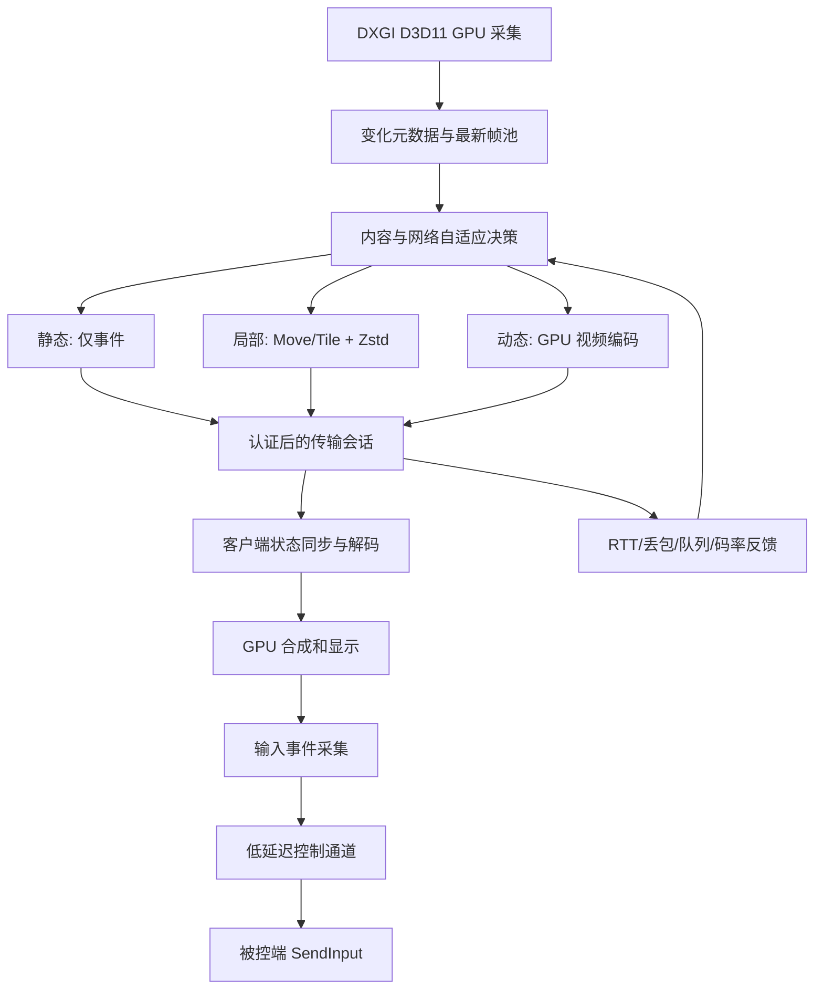
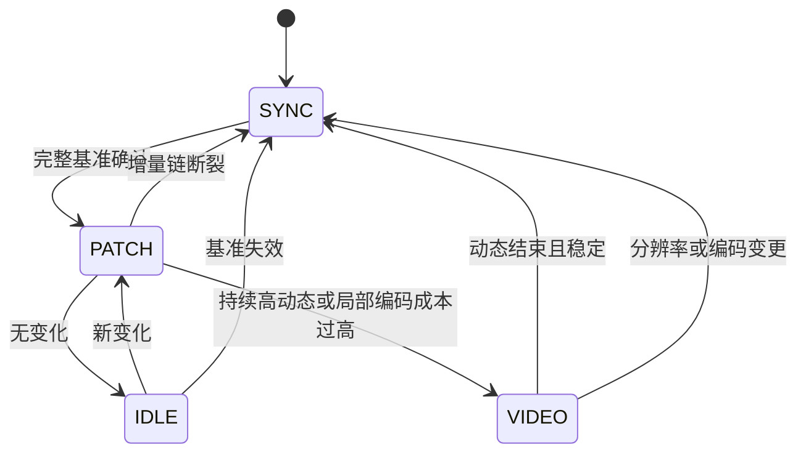

# WiFiDesk — 高性能 WiFi 远程桌面设计规范

> 版本：3.0 · 面向开发者与 AI 编程助手 · Windows 10/11 · LAN First
>
> 产品目标：像本地操作一样流畅，打开即可连接，静态画面几乎不消耗视频带宽，代码文字清晰，界面精致且克制。不是 RustDesk 的复刻，也不是低性能截图 Demo。

## 1. 产品定位与不可妥协的原则

- 两台 Windows 电脑处于同一 WiFi/有线局域网；允许一台电脑开启系统热点供另一台加入。软件不负责建立 WiFi Direct 链路，不依赖互联网、账号、云服务或中继。
- 同一 EXE 可设置固定控制端、固定被控端或双向模式，默认不接受远控；第一版单会话。支持自动发现、免密码确认、可信设备免确认一键连接。
- 从第一版正式架构起就包含混合编码、低延迟传输、硬件加速后端、状态恢复、性能遥测、安全认证和完整视觉设计。允许逐模块开发和验收，不允许用临时 JPEG/TCP 全屏方案作为产品主链路。
- 优先级：安全及正确性、交互延迟、稳定性、文字清晰度、资源效率、极限帧率、包体积。不要为了某个漂亮数字牺牲实际体验。
- Windows 普通用户桌面为首期边界；不绕过 UAC、锁屏、DRM、系统权限或企业网络策略。不实现公网远控、后台隐蔽控制、移动端和多人会议。

## 2. 技术选型：Python 上层 + 原生高速数据面

| 模块 | 首选 | 回退与说明 |
|---|---|---|
| GUI | PySide6 + Qt Quick/QML | 自定义设计系统，GPU 合成；Python 只负责状态和交互 |
| 屏幕采集 | C++17/20 DLL，D3D11 + DXGI Desktop Duplication | Windows Graphics Capture 可作为另一后端；DXcam 用于验证与兼容，不假定其暴露所有元数据 |
| 图像分析 | DXGI dirty/move rect + GPU compute 或原生 SIMD 分块比较 | NumPy 向量化验证；禁止 Python 逐像素循环 |
| 视频编码 | 原生 FFmpeg/libavcodec，NVENC/QSV/AMF 能力探测 | libx264 低延迟软件回退；H.264 基线兼容，HEVC/AV1 为可选协商能力 |
| 局部编码 | 原生 Zstd，独立 tile/rect 数据块 | 小块可直接发送原始像素；可选 LZ4 对照实测 |
| 解码和渲染 | D3D11VA 等可用硬解 + D3D11 纹理渲染 | 软件解码及受控 CPU 上传；不保证所有驱动支持零拷贝 |
| 传输 | 成熟 WebRTC 原生实现：ICE、DTLS-SRTP、RTP/RTCP、拥塞控制、DataChannel | 采用可靠 TLS 通道作为局部更新/控制兼容路径；不自行实现加密或完整可靠 UDP |
| 设备发现 | UDP 广播 + 可选 mDNS | 自动发现为主，手动 IP 仅在高级诊断中备用；发现不能替代身份校验 |
| 输入 | Win32 Raw Input/Qt 事件 + SendInput | 明确焦点、DPI、权限边界 |
| 安全存储 | Windows DPAPI / Credential Manager | 配置 JSON 不存明文密钥 |
| 构建 | Python 3.11/3.12 候选、MSVC Build Tools、Makefile 或 build.py | 不强制 CMake；版本按依赖兼容性锁定 |
| 分发 | PyInstaller onedir + 签名原生 DLL | portable zip；不强制安装驱动或服务 |

首选 WebRTC 后端必须先验证能接入外部硬件编码帧、低延迟解码、局域网 ICE 和统计接口。候选为 libwebrtc 或 libdatachannel + 自有成熟媒体组件；后者不是完整视频引擎，不能假设自带编码、带宽估计、NACK 或 PLI 策略。若原生集成成本过高，aiortc 仅用于协议验证或经测试达标的兼容后端，不声称默认具备 GPU 硬编。不要把 Python 帧对象作为最终高速路径的必经环节。

## 3. 总体架构



Python 管理 UI、设备、授权、配置、策略和遥测；C++ 数据面负责采集、纹理生命周期、编码解码、实时传输与渲染热路径。通过稳定 C ABI 和不透明 handle 连接，避免 Python/C++ ABI 耦合。不要在每帧通过 ctypes 回调传大块像素；只传状态或纹理/缓冲区引用。Qt UI 与 D3D 渲染的互操作需要独立验证；若共享纹理不可用，选择单独原生渲染窗口嵌入或受控上传，不使用每帧 PNG/QPixmap 构造。

## 4. 屏幕采集与内存优化

- DXGI `AcquireNextFrame` 获取纹理与帧元数据；严格配对 `ReleaseFrame`，正确处理超时、设备丢失、显示器热插拔和桌面切换。
- 获取 `GetFrameDirtyRects`、`GetFrameMoveRects` 和指针形状。移动矩形先于 dirty rect 应用，源区域必须来自正确的历史图像；重叠移动使用临时快照或安全复制。
- 原始 BGRA 纹理尽量留在 GPU；视频链路在 GPU 上转换为 NV12/P010（依据协商），避免 GPU→CPU→GPU 往返。局部无损模式只读回必要区域，使用复用 staging texture 和异步读回，合并小块减少调用次数。
- 采用有界纹理池（初始 3–4 个，实测调整）、明确所有权与 GPU fence/query；不能在编码器仍引用纹理时覆盖。
- 变化检测优先使用系统元数据。需要额外检测时采用 64×64 或 128×128 tile（可调），原生哈希/SIMD 或 GPU 比较；哈希碰撞风险应通过实际比较或定期校验/刷新处理。系统 dirty rect 可能合并并包含未变化像素。
- 若采集帧被跳过，不能把最后一帧的 dirty rect 直接当成相对客户端的差异；应合并未提交变化，或基于确认基准重新计算差异，无法保证时发送完整快照。
- 多屏首期选择单个屏幕；支持原生分辨率、旋转、DPI、鼠标坐标映射。HDR 首期明确 SDR 色彩转换或提示不支持。
- 指针可能已经合成进捕获纹理；根据 DXGI 元数据决定是否单独叠加，避免双鼠标。处理颜色/单色/掩码指针及 hotspot。

## 5. 混合传输引擎（首期正式版必须实现）

### 5.1 静态模式 IDLE

画面无变化时不编码、不发送图像；保留必要的心跳、连接反馈和指针事件。客户端保持最后一帧。重新出现变化立即唤醒，不等待固定低帧率周期。静态时视频编码器可保持热状态一段时间，长时间空闲再释放。评估唤醒开销与功耗。

### 5.2 无损局部模式 PATCH

适合 IDE、办公、终端、少量窗口变化。基准完整画面 + MOVE_RECT + PATCH_TILE，原始 BGRA 或 Zstd 无损压缩。矩形合并按总面积、块数和实际压缩成本决策，不机械地合并所有矩形。每个更新批次包含 epoch、base_seq、seq、块位置、像素格式、长度及完整性信息。客户端必须验证边界及长度，先应用 move 再应用 patch，批次完整后提交显示。可选 GPU 局部纹理上传。

可靠有序通道承载增量链；发生丢失、重连、版本不一致或队列溢出时，请求新快照。不得随意丢弃已提交的增量依赖；可合并尚未提交的变化，并生成从客户端已知基准到最新图像的新更新。快照压缩后分块发送，限制并发、大小和解压上限。

### 5.3 动态视频模式 VIDEO

动态画面走 H.264 硬件编码与 RTP/SRTP，目标 1080p60/1440p60，可协商 120 FPS、HEVC、AV1，但不默认开启。关闭 B 帧、长前瞻和不必要的重排序；设置低延迟 preset、受控 VBV、适度 GOP。使用实际编码器支持的参数而非统一照抄命令。以 1080p60 初始 8 Mbps（可配置）启动，动态调整；画质与码率按内容和设备实测决定。

支持关键帧请求、有限期限重传、丢包恢复。禁止随意丢弃已编码参考帧；优先编码前丢弃旧图像，严重拥塞时清理旧会话数据、重新发关键帧。H.264 4:2:0 可能损失彩色文字清晰度，静止后通过无损快照恢复；4:4:4 仅双方确实支持时启用。

### 5.4 自适应状态机



决策输入：变化面积比例、变化频率、move 比例、历史压缩字节数、编码时间、发送队列年龄、RTT、丢包和可用带宽。初始启发式：无变化约 250 ms 进入 IDLE；持续 300 ms 高变化（如面积超过 25% 且变化频繁）或 PATCH 预测成本超过视频预算则切换 VIDEO；低动态持续约 800 ms 后转回无损。以上只是调参起点，使用滞回、最短驻留和冷却期避免抖动。根据实际内容和网络数据调优，不需要 AI 模型。

每次模式切换增加 epoch，丢弃旧 epoch 数据；进入 VIDEO 必须从可独立解码的关键帧开始，返回 PATCH 必须发送完整无损基准并得到确认。过渡期间保留旧画面，直到新模式第一幅完整图像可用。首版不要同时叠加两套独立编码画面；后续可研究视频区域与无损 UI 混合合成。

## 6. WiFi 专项传输优化

WiFi 的主要风险不是平均带宽，而是瞬时干扰、抖动、重传、路由器缓冲膨胀和两台无线设备竞争空口。以延迟预算为核心。

| 逻辑通道 | 传输语义 | 调度 |
|---|---|---|
| 视频 RTP | 实时、允许丢包、加密 | 按拥塞控制限速，有限重传 |
| 局部更新 | 可靠有序，分块 | 有界积压，失步后快照 |
| 键盘/鼠标按钮 | 可靠有序 | 高优先级，小消息 |
| 鼠标绝对坐标 | 无序/有限可靠性 | 最新值优先，序号过滤旧包 |
| 指针形状 | 可靠，形状 ID 缓存 | 变化才发送 |
| 会话与心跳 | 可靠控制 | 不被大帧阻塞 |
| 剪贴板/文件 | 独立低优先级 | 限速，拥塞时暂停 |

逻辑独立不代表物理独立：同一 WiFi 和同一 SCTP association 仍共享拥塞与缓冲。DataChannel 大消息必须分块，检查底层 interleaving 能力和 buffered amount；必要时文件使用独立 TLS 连接。媒体优先，控制保留发送预算，禁止后台文件把路由器队列塞满。

- ICE 仅使用局域网 host candidates 为默认策略，不依赖公网 STUN/TURN。多网卡明确绑定与候选筛选；认证后交换连接参数。UDP 不通时提供可诊断兼容路径，不默默宣称低延迟。
- 采用媒体栈已有的 pacing、拥塞控制、RTCP 反馈。不要把自写固定码率 UDP 洪泛当作优化。RTP 包大小按路径 MTU 确定，初始约 1200 bytes，避免 IP 分片；不要把整张图塞进 UDP 包。
- 有效吞吐取决于双方链路，码率预算应留余量。根据排队延迟趋势、丢包、RTT、编码复杂度逐步升码率，拥塞时快速降码率；先暂停文件，再调整视频码率/分辨率/帧率。不能仅凭 RTT 判断带宽。
- 保持小型自适应抖动缓冲；不追求每一帧都到达。晚到且无恢复价值的数据放弃；参考帧丢失请求恢复。FEC 仅在底层支持且实测有收益时启用。
- 控制消息使用可靠键状态；鼠标位置与点击事件需一致，点击携带当时坐标，按键释放不能被移动消息覆盖。断开、失焦时释放远程已按下的所有键和按钮。
- WiFi 建议使用 5/6 GHz（设备支持且信号良好时），同时提供 2.4 GHz 兼容；同一 SSID 不保证互通，检查访客网络、AP isolation、Windows 防火墙、VPN 和子网。软件不得擅自关闭防火墙。
- 连接诊断展示 RTT、抖动、丢包、发送队列、实际吞吐、编码器类型；区分网络问题和本地性能问题。信号强度可选通过系统 API 查询，未知则显示未知。

## 7. 低延迟调度与渲染

采集、图像分析/编码、网络收发、解码、渲染与 GUI 分离，但避免为每个小操作创建线程。优先原生数据面工作线程，Python 负责编排。使用事件驱动等待而非忙轮询。队列按字节、数量和年龄三重限制，满时有明确恢复策略。

待编码原始帧 mailbox 只保留最新可安全使用的图像；已编码参考帧及已提交增量遵循依赖关系。解码后可丢弃过时显示帧，只绘制最新完整图像。默认最多 1–2 帧显示缓冲；不使用无限 Qt queued signals 传输每一帧。

D3D11 renderer 支持纹理更新、缩放、色彩转换、鼠标合成、黑边、整数/原始比例和全屏。尽量使用 DXGI flip model 与适当的低延迟 present 策略；允许选择同步显示或低延迟优先，避免无条件关闭同步导致撕裂。Windows DWM、显示刷新率及 Qt 合成路径均需实测。

延迟链路按采集等待、分析、编码、发送排队、传输、解码、渲染等待分别记录单调时钟。跨机器单向时间需时钟同步与误差估计；最终输入到屏幕反馈用高速相机或可验证的光学/物理测试，不用 ping 伪装总延迟。

## 8. WiFi 自动发现、角色设置与免密码连接（P0）

### 8.1 角色设置

同一个 WiFiDesk.exe 首次启动以三张简洁卡片选择角色，随时可在设置中修改并持久化：

| 角色 | 主界面 | 网络及权限行为 |
|---|---|---|
| 控制端 | 自动列出可连接电脑，点击连接 | 不开放远控监听，不启动屏幕采集，不允许其他电脑控制本机 |
| 被控端 | 显示允许连接、授权模式、可信设备和当前控制者 | 仅在明确允许后启动监听和发现响应；连接前不采集、不编码 |
| 双向模式 | 同时提供附近设备与被控开关 | 两种能力均可独立关闭，默认禁止互相递归控制 |

默认首次启动不允许远控。固定角色重启后保持；退出应用即停止远控。被控端可选择最小化到托盘，必须有可见状态和立即断开按钮；开机启动单独选择，默认关闭。控制端关闭窗口释放所有远端按键与鼠标状态。角色切换先结束不再允许的会话再更新网络监听。

### 8.2 三种授权模式

- **免密码 · 每次确认（默认）**：控制端点击设备，被控端弹出请求，点击允许即可，不输入任何密码。首次建立信任时使用双方可核对的短认证串或成熟的经认证密钥交换；短串只用于身份核对，不需要手工录入。
- **免密码 · 可信设备自动连接（推荐固定两台电脑）**：首次确认并保存控制端公钥指纹，被控端明确启用该设备的自动授权。之后在控制端点击连接即可，无密码、无每次确认弹窗。可随时撤销，撤销时立即断开现有会话。
- **配对码模式（可选）**：使用成熟配对协议及一次性短码、限速和有效期。不得把短码直接作为加密密钥。

免密码不是无认证。不得把所有同 WiFi 设备自动设为可信，不实现开放匿名控制。设备名、IP、MAC、SSID 均不是身份凭据。使用 DPAPI/Windows Credential Manager 保护私钥，固定对端公钥身份并绑定 TLS/WebRTC 会话；身份变化要求重新授权。授权区分键鼠、只读、剪贴板和文件权限。首次连接必须得到被控端真实授权，禁止默认同意、隐藏状态或绕过权限。

### 8.3 自动发现：用户不需要输入 IP

启动后自动枚举实际启用的局域网接口，优先 WiFi，其次有线；默认排除回环、VPN、虚拟网卡和公网配置，提供高级接口选择。使用专用 UDP 发现端口，建议默认 47381（可配置，实际发布前检查冲突），控制端按接口发送子网广播探测，被控端向请求来源单播回复；可选 mDNS 作为补充。发现协议仅传 magic、版本、设备 ID、显示名、角色、服务端口和能力提示，不发送密码、密钥或画面。实际连接地址使用收到的报文来源并进行认证，不盲信报文声明的地址。

- 启动即时探测，前几秒快速发现，之后约 2–5 秒一次并加入随机抖动；离线超时约 10–15 秒，可按测试调整；界面不反复闪动。
- 发现报文建议不超过 512 字节；严格验证、限速、去重，不进行全网 IP 扫描、ARP 欺骗、端口扫描或反复探测其他服务。
- 设备 ID 稳定，IP 变化后自动更新端点，不产生重复卡片；WiFi 切换、DHCP 更新、睡眠唤醒后重新发现。
- 已配对且在线设备排第一；点击卡片直接完成握手、能力协商、同步首帧和打开远程窗口。手动 IP 只在高级诊断提供，不是正常流程的必填项。
- 默认禁止公网候选、中继与外部 STUN/TURN；在支持的本地接口上建立直连，验证实际媒体连接路径。
- 同 SSID 不保证互通：访客网络、AP 隔离、不同 VLAN、防火墙和企业策略可能阻断发现或连接。显示具体诊断及解决方法，不假装发现成功，不自动修改路由器或系统网络配置。

### 8.4 不影响其他软件与 WiFi 共存

- 不使用 80/443 等常见服务端口，不占用其他应用端口；监听失败时明确提示并选取可用服务端口，发现回复公布实际端口。发现端口固定且冲突时提示调整两端配置，不强行抢占。
- 使用单实例机制；禁止安装网络过滤驱动、全局代理、虚拟网卡、修改 DNS、路由表、系统代理、全局键盘钩子或系统防火墙全局策略。键鼠捕获仅在远程窗口拥有焦点且捕获开启时生效。
- 视频采用拥塞控制及发送 pacing；默认动态码率上限可从 12–20 Mbps 起步并按实测调整，用户可设上限；根据 RTT、排队延迟、丢包主动降码率。不得因为 WiFi PHY 标称速率高就占满链路。
- 文件传输独立限速并在交互拥塞时暂停；心跳和键鼠优先。空闲时释放采集/编码资源，停止无意义视频包，避免高频轮询和后台 CPU 占用。
- 不承诺零影响：共享 WiFi 的空口资源有限，必须与网页、视频会议、下载等并行测试，记录其他应用的延迟、吞吐变化，并允许节能/低带宽模式。

### 8.5 会话与恢复

DISCOVERED → CONNECTING → AUTHENTICATING → NEGOTIATING → SYNCING → ACTIVE → RECONNECTING / CLOSED。网络断开指数退避并加入抖动，重新发现原可信设备，重新认证及完整同步后恢复；主动断开或撤销信任后不得自动重连。被控端持续显示远程控制状态、对端名称与断开按钮。剪贴板及文件独立授权，禁止远端任意路径写入或自动执行文件。

## 9. 协议规范

控制消息使用精简二进制结构或 CBOR/MessagePack，避免 Base64 图像。定义协议 major/minor、能力协商与最大消息长度。固定字节序、明确整数宽度，避免直接跨网络发送未对齐 C struct。

控制帧建议字段：magic、version、type、flags、payload_len、session_id、epoch、seq、timestamp；媒体 RTP 使用标准头部，应用元数据通过协商的扩展或关联控制消息传递，不重复发明 RTP。PATCH 增加 base_seq、显示器 ID、分辨率、矩形数量、块编码与原始长度。序号回绕规则、超时、错误码写入 protocol.md。

消息类别：HELLO/CAPABILITIES、PAIR/SESSION、DISPLAY_CONFIG、MODE_SWITCH、SNAPSHOT/PATCH/MOVE、RESYNC_REQUEST、INPUT/INPUT_RESET、CURSOR、STATS、PING/PONG、CLIPBOARD、FILE_OFFER/CANCEL、DISCONNECT。媒体安全使用 DTLS-SRTP；其他数据使用已认证 DTLS/SCTP 或 TLS。任何载荷先校验长度和资源上限，再分配内存；禁止 pickle、任意对象反序列化和未验证的压缩数据。

## 10. 高颜值视觉设计系统

产品风格：现代桌面工具，接近精致的 Windows 原生应用与专业开发工具的结合，不仿 RustDesk，不做网页套壳，不做廉价霓虹渐变、满屏卡片、无意义动画或巨大标题。

| Token | Dark（默认） | Light |
|---|---|---|
| Background | #101318 | #F5F7FA |
| Surface | #191E26 | #FFFFFF |
| Elevated | #222936 | #EDF1F6 |
| Border | #2B3442 | #DCE2EA |
| Primary text | #EDF2F8 | #182230 |
| Secondary text | #A5B1C2 | #526276 |
| Accent | #67A9FF | #245CCB |
| Success | #55C99B | #147C59 |
| Warning | #E8B86B | #986300 |
| Danger | #F27682 | #BB3046 |

字体 Segoe UI Variable / 系统中文字体回退，数据用等宽或 tabular numbers。字号 12/13/14/16/20 px（逻辑单位）；8 px 网格，间距 4/8/12/16/24/32；窗口卡片圆角 10–12，按钮 8，细边框与轻阴影；统一 Lucide 风格线性图标（核查许可证）。支持系统主题、高 DPI、键盘 Tab 焦点、减少动画。颜色不能是唯一状态提示。主按钮对比度按 WCAG 4.5:1 目标验证，不直接假定配色均合格。

### 10.1 主界面：打开软件就能连接

建议默认逻辑尺寸 760×480，可缩放；无复杂导航栏，左上品牌 WiFiDesk + 简洁 WiFi/显示器图形，右上设置。顶部显示当前网络及本机名称、角色切换和被控开关。控制端只显示附近可控设备；被控端突出免密码模式、允许连接和可信设备；双向模式显示两者。主体为附近设备列表，已配对在线优先；每行设备图标、名称、在线状态、次要 IP 信息、一键连接按钮。底部折叠高级诊断（含手动 IP）与版本号。首次配对弹窗只显示必要信息，拒绝和接受同样容易找到；可信设备自动连接时不弹密码框。

```text
┌──────────────────────────────────────────────────────────┐
│  ◉ WiFiDesk                                  ⚙     ─ □ × │
│  本机 DESKTOP-A   ·   局域网已连接       允许连接 [开启]  │
│                                                          │
│  附近的设备                              2 台在线        │
│  ┌────────────────────────────────────────────────────┐  │
│  │  ▣  Laptop-Pro     已配对 · 在线         [连接桌面] │  │
│  │     192.168.1.103                                  │  │
│  └────────────────────────────────────────────────────┘  │
│  ┌────────────────────────────────────────────────────┐  │
│  │  ▣  Office-PC      未配对                [配对连接] │  │
│  └────────────────────────────────────────────────────┘  │
│                                                          │
│  角色：控制端 ▾              网络诊断          v1.0     │
└──────────────────────────────────────────────────────────┘
```

设备不存在时展示明确空状态和排障入口，不显示假的在线设备。连接按钮立即进入可取消的状态；完成后直接打开远程窗口。动效 100–180 ms，仅用于过渡和悬停，禁用高开销模糊；远程窗口不对实时图像做装饰特效。

### 10.2 远程窗口

最大面积留给桌面内容，默认顶部悬浮工具栏，可自动隐藏、固定或全屏。工具栏：设备名、显示模式、画质、屏幕选择、剪贴板/文件、全屏、断开。小型状态区显示实际 FPS、RTT、码率、编码模式；详细性能面板按需打开。缩放方式支持适应窗口、1:1、全屏和保持比例；黑边区域不发送远程点击。提供快捷键退出全屏及释放键鼠捕获。

### 10.3 设置与状态

仅保留常用页：通用、显示与性能、连接与安全、高级诊断。默认 Auto 模式，无需用户理解 H.264/HEVC/码率。另提供清晰办公、低延迟、节能三个预设，所有参数可恢复默认。显示当前实际硬编/硬解状态，回退原因透明。网络异常时保留最后画面并展示重连提示，不让窗口无响应。日志只记录诊断元数据，不默认保存桌面像素、按键、剪贴板或密钥。

## 11. 工程结构与接口

```text
WiFiDesk/
  main.py
  app/                 # 生命周期、配置、会话状态、设备发现
  ui/
    Main.qml
    RemoteToolbar.qml
    Settings.qml
    components/        # 统一按钮、设备行、对话框
    theme/             # dark/light tokens
  core/                # Python 策略、后端能力、指标、授权
  native/
    include/wifidesk.h # 稳定 C ABI
    capture/           # DXGI/WGC
    codec/             # HW/SW 编解码与纹理池
    diff/              # dirty/move/tile 与无损压缩
    transport/         # 成熟协议栈适配器
    render/            # D3D11 与显示
    input/             # Win32 输入注入
  protocol/            # 规范、消息类型、测试向量
  tests/               # 单元、集成、网络与基准测试
  assets/              # SVG、图标、许可证
  Makefile
  build.py
  requirements.lock
  README.md
  THIRD_PARTY_NOTICES.md
```

接口建议：CaptureBackend.start/stop/acquire/release；DiffBackend.compute/reset；EncoderBackend.probe/configure/submit/request_idr；DecoderBackend.submit/reset；TransportBackend.connect/send/feedback/close；RendererBackend.present/resize。后端能力对象包含实际支持格式、最大分辨率、硬件路径及错误原因。资源所有权、线程安全、关闭顺序必须在接口契约中明确。C ABI 用固定类型、不透明 handle、版本号、错误码；不跨边界传 STL、异常或不明确所有权的指针。

## 12. 性能目标与验收（非实测承诺）

测试基线：两台具有可用硬编/硬解的现代 Windows 电脑、良好 5 GHz WiFi、1080p60 显示。记录硬件、驱动、路由器、信号、分辨率、内容类型、是否双无线与软件版本。

| 指标 | 初期正式版目标 | 验证方法 |
|---|---|---|
| 已配对连接到首帧 | 1–2 秒内典型 | 至少 30 次，记录 p50/p95 |
| 输入到远程画面反馈 | p50 ≤50 ms，p95 ≤100 ms | 高速相机/物理输入反馈测试 |
| 动态画面 1080p60 | 持续接近 60 FPS | 统计有效新显示帧与掉帧率 |
| 1440p60 | 支持且符合延迟预算 | 真实硬件测试 |
| 4K/120 FPS | 高阶设备可选目标 | 能力协商后单独验收 |
| 静态桌面 | 稳定后无新增图像流量 | 抓包区分心跳和视频载荷 |
| 静态文字 | PATCH 同像素格式下逐像素一致 | 与基准图像比较，排除鼠标/色彩转换 |
| 常规动态带宽 | 约 4–15 Mbps 的初始调参区间 | 以质量和延迟共同验收 |
| CPU | 硬件路径单端平均 ≤10% 的整机占用参考目标 | 记录 CPU 型号、进程 CPU、GPU 引擎 |
| 稳定性 | 8 小时持续会话无崩溃、无单调内存增长 | 采集 working set/纹理数量/句柄 |
| 网络恢复 | 网络恢复后自动认证并恢复画面 | 人工断网、切网、睡眠唤醒 |

延迟与 CPU 目标只在定义好的基准环境下验收，弱 WiFi 或不支持硬编的机器允许降级，不能伪造帧率或隐藏回退。每次优化对比 p50/p95/p99、带宽、CPU/GPU、内存和质量；不要仅测平均 FPS。

测试矩阵：静止桌面、VSCode 输入/滚动、拖窗、浏览器动画、1080p 视频；2.4/5/6 GHz、双无线/一端有线；网络模拟 1/3/5% 丢包、10–50 ms 抖动、限速及突发断网；分辨率变化、显示器拔插、DPI 125/150%、休眠、重连、编码器失效、不同显卡、鼠标按键断线。测试增量帧错序、重复、截断、超大载荷、错误 epoch、压缩炸弹、配对身份变化。测试文件传输时视频与输入仍正常。

## 13. 实施顺序：架构一步到位，模块逐项验证

1. 建立协议、数据生命周期、状态机、UI 设计 token 和性能基准工具；验证实际硬编、硬解、GPU 纹理共享、原生媒体后端接入及许可证。该阶段是技术风险验证，不是另写低性能产品。
2. 完成 DXGI 采集、纹理池、dirty/move 元数据、局部无损快照/增量和客户端像素一致性测试。
3. 完成 GPU 视频编解码、原生渲染与成熟实时媒体传输，实测延迟；实现软件编码回退。
4. 完成混合模式状态机、拥塞反馈、队列限制、关键帧/快照恢复、鼠标独立通道。
5. 完成角色设置、自动发现、免密码可信授权、键鼠、重连，以及已设计好的高颜值 UI；所有状态对应真实后端，不能用假按钮或硬编码 FPS。
6. 集成剪贴板与可限速文件传输、诊断、打包。进行真实 WiFi A/B 测试，对照 Sunshine/Moonlight、RustDesk 的直连模式（相同画质与网络），用数据决定后续优化。

每阶段可独立构建、测试、回归；第一版对外发布前所有 P0 项必须通过。首期就设计硬件后端和混合协议，但不可在未验证 GPU/协议能力时宣称已实现。优先使用实际测得的瓶颈，而非盲目增加线程或算法。

## 14. 开源参考与许可证

- [DXcam](https://github.com/ra1nty/DXcam)：Python 采集验证、接口参考。
- [Microsoft Desktop Duplication API](https://learn.microsoft.com/en-us/windows/win32/direct3ddxgi/desktop-dup-api)：dirty/move rect、指针和 DXGI 正确性依据。
- [Sunshine](https://github.com/LizardByte/Sunshine)：硬件编码、低延迟串流架构参考。
- [Moonlight Qt](https://github.com/moonlight-stream/moonlight-qt)：解码、渲染、输入与串流体验参考。
- [TigerVNC](https://github.com/TigerVNC/tigervnc)：局部更新与 framebuffer 同步参考。
- [FFmpeg](https://github.com/FFmpeg/FFmpeg)、[PyAV](https://github.com/PyAV-Org/PyAV)：编解码后端及 Python 验证。
- [Zstandard](https://github.com/facebook/zstd)：无损压缩。
- [WebRTC](https://webrtc.googlesource.com/src/)、[libdatachannel](https://github.com/paullouisageneau/libdatachannel)、[aiortc](https://github.com/aiortc/aiortc)：实时媒体及数据通道候选。
- [RustDesk](https://github.com/rustdesk/rustdesk)：权限与桌面交互边界参考，不直接 Fork。

这些是候选参考入口，本设计未在线核验当前版本、构建能力或许可证细节。正式采用前锁定 commit/version 并核查源码、二进制分发义务。GPL/AGPL 项目不要直接复制进不兼容的闭源产品；FFmpeg 的构建选项、libx264、编解码专利、Qt/PySide6 和图标素材均需单独评估。参考架构不等于拥有复制源码的授权。

## 15. 给 AI 编程助手的强制约束

- 不把 PyAutoGUI/PIL 循环截图、全屏 JPEG、Base64、纯 Python 逐像素处理作为正式方案。
- 不用无界队列，不让 GUI 主线程做编解码、网络阻塞和大块内存拷贝；不为每一帧创建线程、进程或临时文件。
- 不虚构硬件加速、零拷贝、低延迟数据或测试结果；必须提供实际后端探测、日志和基准工具。
- 不随意丢弃参考帧或增量更新，不在模式切换时混用基准；失败必须能恢复。
- 不自行设计密码学、关闭防火墙、默认信任局域网或实现隐蔽无人值守。
- 不堆叠复杂框架、微服务、数据库、Electron 或浏览器壳；只引入确实必要的依赖。
- 不用默认 Qt 控件堆砌敷衍 UI；QML 组件复用，视觉 token 统一，布局可缩放，实际状态绑定完整。
- 输出可构建的完整文件及明确目录、Makefile/build.py、依赖锁定、运行和测试命令；不要只给碎片代码或伪实现。
- 遇到能力不支持时明确报错并提供经过测试的降级路径；不得静默降级后仍显示硬件加速。

## 16. 最终交付标准

两台电脑解压运行，自动发现，按固定角色运行，首次安全授权后可免密码一键连接；远程桌面流畅，静态及文本操作采用无损局部优化，高动态画面使用硬件视频编码，网络拥塞时主动保持低延迟，断网后恢复正确状态。交付 portable 安装包、源码、构建脚本、协议说明、依赖许可清单、真实基准报告和故障诊断说明。

最终成功不是功能数量或代码行数，而是用户每天愿意使用：连接比传统工具更简单、画面更清晰、交互更及时、界面更精致。所有性能优势必须通过相同条件下的实测证明。


## 17. Windows 实际运行、权限与分发规范（发布阻断项）

### 17.1 普通用户可运行优先

- 默认 EXE manifest 使用 asInvoker；不要求关闭 UAC、不依赖管理员身份才能启动主界面、发现设备、连接、采集普通桌面或操作普通权限程序。
- Windows SendInput 受 UIPI 限制：普通权限进程不能向更高完整性级别程序可靠注入输入。若需要操作用户主动打开的管理员程序，提供明确的本机“以管理员身份重新启动”入口，由本机用户确认系统 UAC；不能远程代替确认，也不承诺操作安全桌面、锁屏、受保护内容。采集失败或黑屏需提示具体限制。
- 调用 SetProcessDpiAwarenessContext 或采用正确 manifest，在窗口创建前建立 DPI 感知；测试混合 DPI、多屏坐标、鼠标按键释放和输入法。SendInput 返回值异常时提示可能的权限限制，不伪造成功。
- 不使用注入第三方进程、驱动、系统服务、关闭杀毒软件或绕过系统防护来解决兼容性。安全软件误报走签名和正规申诉流程。

### 17.2 Windows 防火墙与局域网访问

首次启动检测网络配置类别、绑定地址、监听端口及实际发现结果。控制端通常仅需出站连接及发现响应；被控端需要允许对应入站发现及服务。采用 Windows 防火墙正常授权流程，必要时提供独立、可审查的本机管理员配置工具，仅添加本程序及实际使用端口的规则，限定 Private 网络与 LocalSubnet；默认不开放 Public 网络。退出或卸载时提供清除本软件创建的规则选项，不删除其他应用规则。不得无提示修改系统防火墙、强制切换网络类别或绕过组策略。若用户拒绝授权，程序仍可正常打开并展示可操作的故障诊断。

### 17.3 一键构建与完整发布产物

- Windows x64 为首期目标；锁定实际验证过的 Python、PySide6、FFmpeg、原生编译器和第三方库版本。主入口 `build.py`，可附 Makefile；自动检查工具链、构建原生 DLL、打包 QML/图标/Qt 插件/编解码依赖，检查返回码及产物。不得只编译 Python 或只生成空壳 EXE。
- 推荐 PyInstaller onedir，交付 `dist/WiFiDesk/WiFiDesk.exe` 与其依赖目录及 portable ZIP；不能仅复制 EXE 丢失 DLL。按许可分发 VC runtime 或给出正规安装提示；不依赖开发机 PATH、Python 安装、工作目录或 IDE。使用安全 DLL 搜索路径，支持中文和空格目录。
- 构建后运行实际产物 `WiFiDesk.exe --self-test`（真实检查 QML、DLL 加载、网络绑定、能力探测与编码器回退）；随后执行真实 GUI 启动冒烟测试，不允许 --self-test 只是打印成功。实际日志写入用户可写目录，异常捕获并提供可复制诊断。没有交互式 Windows 环境的 CI 只能标记相关项未验证，不能冒充已通过。
- 对正式分发建议 Authenticode 签名；未签名便携版可能触发 SmartScreen，不能保证任何 Windows 都不提示。保留 SHA-256、版本、依赖清单和签名状态，绝不要求关闭 Defender 或系统保护。

### 17.4 编译成功不等于交付成功

以下为必须实际运行的验收矩阵；任何必选项未执行或失败都不能标记正式版完成。

| 测试项 | 通过要求 |
|---|---|
| 干净 Windows 10/11 x64 | 无 Python/IDE 环境下解压双击启动，GUI 与 DLL 正常加载 |
| 普通账户 | 不提升权限即可发现、连接并操作普通桌面 |
| 固定角色 | 重启后角色保留；控制端不开放远控；被控关闭后停止监听与控制 |
| 同 WiFi 自动发现 | 两台物理电脑同网，无手工 IP；良好网络目标 3 秒内发现 |
| 免密码 | 首次明确授权后，可信设备可一键连接；重启后仍可使用，撤销立即生效 |
| 未授权设备 | 即使同 WiFi 也无法获取画面或发送有效输入 |
| 键鼠 | 点击、拖动、滚轮、组合键、中文输入路径及断线释放实测 |
| 权限限制 | 管理员窗口/UAC/锁屏等不可操作时正确反馈，不崩溃 |
| 防火墙 | 允许、拒绝、Private/Public、端口冲突、AP 隔离均给出真实状态 |
| 硬件差异 | 至少测试可用硬编及软件回退；缺失 GPU 编码器仍可连接 |
| WiFi 共存 | 同时运行网页、视频会议、下载；测试延迟、丢包、CPU/GPU/带宽，拥塞时自动让出带宽 |
| 网络变化 | WiFi 切换、IP 变化、睡眠恢复、断线重连与画面状态恢复 |
| 长时间稳定 | 持续运行至少 8 小时，无无界内存增长、输入卡死或延迟持续积累 |
| 退出清理 | 无残留采集、编码、网络监听或输入捕获；不影响其他程序 |

### 17.5 给开发 AI 的最终执行要求

必须交付完整可构建源码与依赖，实际执行构建命令，修复编译错误，再启动生成的 EXE，检查日志并完成可用环境内的测试。若实际 Windows 双机环境不可用，明确列出未验证项目、原因和复现命令；不得声明已编译或已运行。禁止用占位按钮、假在线设备、硬编码性能或未实现的网络协议充当完成品。发布报告记录每项 PASS/FAIL/NOT RUN、环境、版本和证据。优先解决真实可运行性，再以性能基准持续优化，不因追求极限而牺牲安全与稳定。
